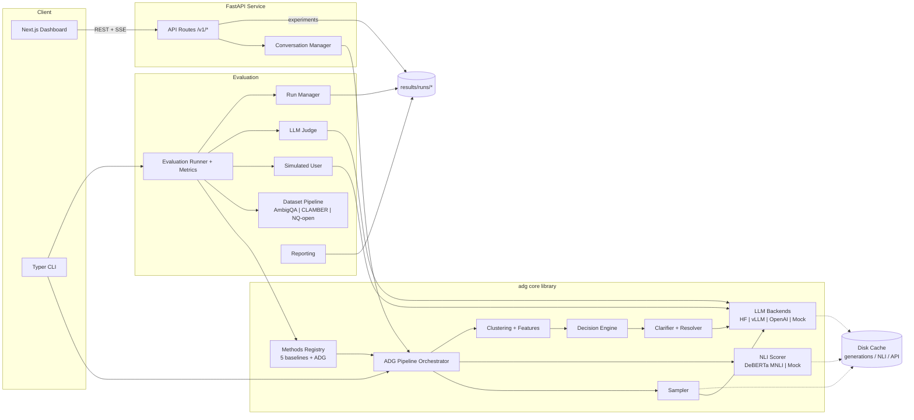
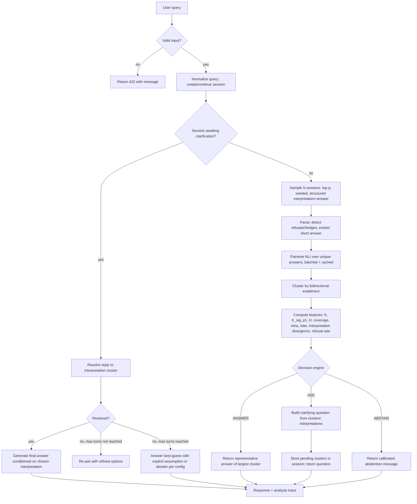

# Ask, Don't Guess: Analysis and Claude Code Master Implementation Prompt

This document follows the six-part output format in your brief. **Section 4 is the deliverable**: copy everything between the `BEGIN PROMPT` and `END PROMPT` markers into Claude Code. The same prompt is also provided as a standalone file, `Ask_Dont_Guess_ClaudeCode_Prompt.md`.

Labels used throughout: **[Proposal]** = taken from your proposal and slides; **[ER]** = an engineering recommendation added to make the project implementable or more rigorous. Nothing tagged [ER] changes your research claim without a proposal-faithful alternative being kept.

---

## 1. Understanding of the Research Project

**Problem [Proposal].** When a request has more than one reasonable meaning ("Book a table at the Italian place near my office" with two such restaurants; "What is the capital of Georgia?"), LLMs usually pick one interpretation and answer fluently. The user often doesn't notice that a different question was answered. This is worse for small open models (1.5B–3B parameters) that run on phones and cheap servers, which is the deployment setting you target.

**Research question [Proposal].** Can a small LLM cheaply and reliably decide when to **answer**, when to **ask** a clarifying question, and when to **admit it doesn't know**, and can it ask a question that targets the real competing interpretations?

**Proposed solution [Proposal].** A training-free, inference-time wrapper:
1. Sample about 8 answers with nucleus (top-p) sampling.
2. Group them by meaning using an off-the-shelf NLI model.
3. Read the *pattern* of groups: one meaning → ANSWER; a few coherent, distinct meanings → ASK; scattered answers → ABSTAIN.
4. When asking, turn the meaning groups into concrete options ("Do you mean Georgia the US state or Georgia the country?").
5. Resolve the user's reply and answer for the chosen interpretation.

A DPO fine-tune that teaches the model to ask without sampling is an optional stretch goal.

**Positioning [Proposal].** AmbigQA, ClariQ and CLAMBER define and measure the problem. Semantic entropy (Kuhn et al., ICLR 2023) uses the same sample-and-cluster idea but reduces it to one uncertainty number, built for hallucination detection. STaR-GATE trains models to ask, which is expensive. Your contribution is **not a new uncertainty measure**: it uses the *structure* of the meaning clusters to separate **ambiguity** (which calls for a question) from **ignorance** (which calls for an abstention), and to write the question itself.

**Evaluation [Proposal].** AmbigQA and CLAMBER (ambiguous) plus NQ-open (clear control); Qwen2.5-1.5B/3B-Instruct and Llama-3.2-3B-Instruct, with GPT-4o-mini as reference model and simulated user. Five baselines: always answer, "ask if unclear" prompting, stated confidence, token log-prob threshold, and semantic entropy. Metrics: asking precision and recall, clarifying-question quality (LLM judge plus human check), end-to-end accuracy with a simulated user, and cost at an equal budget. Validity checks: 50 hand-checked cases, simulated-user and judge validation, and relabeling to measure annotation noise.

**Expected outcome.** A working library, CLI, API and demo UI that shows *why* each decision was made, and a reproducible experimental comparison against the baselines. Whether the method wins is an **open empirical question**: the deliverable is an honest measurement, not a guaranteed improvement.

---

## 2. Technical Feasibility and Research Analysis

### 2.1 What is clearly feasible in the time available (about 3 weeks to December 10)
- Sampling 8 answers from 1.5B–3B models with HF Transformers on one consumer GPU or a free Colab T4. Qwen2.5-1.5B is also usable on CPU or Apple Silicon for demos.
- NLI scoring with a DeBERTa-MNLI model. For N = 8 there are at most 56 directed pairs per query, and far fewer after exact-duplicate removal. With batching this costs well under a second on a GPU.
- Clustering, features and rule-based decisions: cheap, pure-Python and fully unit-testable with mocks.
- All five baselines: each is a prompt, a score and thresholds, and the semantic-entropy baseline reuses the clustering code.
- Evaluation on the AmbigQA dev set and NQ-open subsets with a rule-based (offline) simulated user; GPT-4o-mini optional.
- A FastAPI + Next.js demo in mock mode, then with real models.

### 2.2 Ambiguities in the proposal, and recommended defaults [ER]

| # | What the proposal leaves open | Why it matters | Recommended default |
|---|---|---|---|
| 1 | **How to tell ambiguity from ignorance when both produce several clusters.** "4 × Atlanta + 4 × Tbilisi" (ambiguous) and "4 × 1997 + 4 × 1998" (model unsure) look identical to cluster counts alone | This is the core claim. If the method can't separate these, it collapses into semantic entropy with two thresholds | Keep the proposal's cluster-structure method as **ADG-Core**, and add an **interpretation channel** (**ADG+IC**): each sample also states how it read the question, and answer groups that align with *different readings* indicate ambiguity. Report both. **This is the most important methodological decision; the team should approve it explicitly** |
| 2 | What counts as "a few coherent meanings" | Thresholds decide everything | Defined features (largest share, significant clusters, coverage, intra-cluster consistency, inter-cluster separation, Δ), with thresholds **calibrated on a held-out calibration split**, never hand-tuned on test |
| 3 | No dataset labels "the model doesn't know" | ABSTAIN can't be scored without a gold label | Model-dependent gold labels: a clear question is "should abstain" for a given model if that model's majority answer is wrong. Asking precision and recall still use the dataset's ambiguity labels, exactly as in the proposal |
| 4 | Which interpretation the simulated user intends | It defines end-to-end accuracy | For each AmbigQA ambiguous item, evaluate each annotated interpretation as the hidden intent (or a seeded sample of them) |
| 5 | CLAMBER's format and whether it includes interpretations with answers | It determines whether CLAMBER can be used end to end | Claude Code verifies the official repo first. If there are no per-interpretation answers, use CLAMBER for ASK precision/recall and question quality only |
| 6 | Fair budget | Our method uses about 8 samples vs 1 for most baselines | Report actual costs, and add equal-sample variants (majority vote at N, averaged confidence at N) plus a budget sweep (N = 2, 4, 8, 16) |
| 7 | NLI behavior on very short answers and numbers | "Atlanta" alone is hard to judge; NLI often treats "1878" and "1879" as near-equivalent | Feed "Q: … A: …" pairs to the NLI model (as in semantic-entropy work), plus a configurable number/entity guard |
| 8 | Clustering algorithm | NLI equivalence isn't transitive | Average-linkage agglomerative clustering for ADG; greedy bidirectional clustering for a faithful semantic-entropy baseline; connected components only as an ablation |
| 9 | Simulated user and judge both being GPT-4o-mini | Self-preference bias; a "too helpful" user inflates accuracy | A rule-based offline user by default, a leakage guard, a different prompt and role for the judge, and human validation on 50 cases |
| 10 | Hardware and API access | Unknown | Claude Code inspects the hardware and keys first; mock mode and local-only paths always exist |

### 2.3 Research-validity pitfalls to design against
- **Recall ceiling from sampling:** if a small model *always* reads "Georgia" as the US state, no amount of clustering will reveal the other meaning. The prompt adds a "sample interpretation coverage" metric so you can report how much missed recall is caused by sampling rather than by the decision logic.
- **Threshold overfitting:** calibrate per model, on a calibration split only; report cross-validation spread.
- **Data leakage:** AmbigQA questions come from NQ-open, so the clear control set must exclude them (the prompt requires dedup and logging).
- **Label noise:** some "single-answer" AmbigQA items are arguably ambiguous; the relabeling study quantifies this.
- **Temperature confound:** answer diversity depends on temperature, so keep sampling settings fixed across methods and include a temperature or budget ablation.
- **Training-data contamination:** small models may have memorized NQ-style questions; mention it as a limitation.
- **Mock results leaking into reports:** the prompt makes the reporting pipeline refuse to build paper tables from mock runs.

### 2.4 Methodological limitations to state in the report
English only; open-domain factual QA dominates the data; NLI-model errors propagate into the clusters; the simulated user is an approximation of real users; small models' samples may not cover all interpretations; thresholds are calibrated per model and may not transfer; latency is 8× sampling plus NLI compared with a single answer.

---

## 3. Recommended System Architecture (summary)

- **Stack:** Python 3.11, uv, PyTorch, HF Transformers/Datasets, a DeBERTa-MNLI NLI model, scipy/scikit-learn for clustering and metrics, pydantic for config and schemas, Typer CLI, structlog, FastAPI (+SSE), and Next.js + TypeScript + Tailwind + shadcn/ui + Recharts for the UI. Optional extras: OpenAI, bitsandbytes, vLLM, W&B/MLflow, TRL/PEFT for DPO. LangChain, Hydra and databases are explicitly avoided as unnecessary.
- **Architecture:** a model-agnostic core library (`adg`) with backends for HF, vLLM, OpenAI and Mock; an NLI scorer; sampler → relations → clustering → features → decision engine → clarifier/resolver → conversation manager. Around it sit methods (5 baselines + ADG-Core + ADG+IC), a dataset pipeline, a simulated user, an evaluation runner, run tracking and reporting. The API and UI are thin clients of the library.
- **Data flow:** query → 8 structured samples (interpretation + answer) → exact dedup → pairwise NLI (cached) → clusters → features → rules → ANSWER / ASK (+ options) / ABSTAIN, with a full trace → (if ASK) the user's reply → resolver → final answer.
- **Core algorithm:** features include the largest cluster share, entropy, the number of significant clusters, coverage, intra-cluster consistency, inter-cluster contradiction and interpretation divergence (+IC). An ordered rule list with calibrated thresholds makes the decision; a shallow learned decision tree is an ablation.
- **Models and datasets:** Qwen2.5-1.5B as the default (fast, ungated), Qwen2.5-3B as the main larger model, and Llama-3.2-3B if the license is accepted and time allows. GPT-4o-mini is optional as reference, user and judge. AmbigQA dev is the primary evaluation set, NQ-open (deduplicated) the clear control, and CLAMBER is verified first, then used as far as its labels allow.

The full detail, including Mermaid diagrams, schemas, maths and file-by-file contracts, is in Section 4.

---

## 4. Complete Claude Code Master Implementation Prompt

`===================== BEGIN PROMPT (copy from the next line) =====================`

# MASTER IMPLEMENTATION PROMPT — "Ask, Don't Guess"

> **How to use this document:** Give this entire file to Claude Code as the project brief. Also save it in the repository as `docs/SPEC.md`, and create a short `CLAUDE.md` at the repo root that points to it (instructions in §0.4). The document is long on purpose: it should leave no important engineering decision to guesswork.

---

## 0. INSTRUCTIONS TO CLAUDE CODE (READ FIRST)

You are acting as a **senior ML research engineer and software architect** on a 4-person university research team. You will build a production-quality, research-grade Python system called **Ask, Don't Guess (ADG)**. It has to work both as a research artifact (reproducible experiments, honest baselines, statistical rigor) and as a portfolio-quality software project (clean architecture, tests, CI, documentation, a polished demo).

### 0.1 Non-negotiable working rules

1. **Inspect, then plan, then code.** First inspect the repository and environment (§0.5), then produce a written plan for Phase 1 (§20) and confirm it with the user. Use plan mode if it is available.
2. **Work in phases** (§20). Before each phase, state what you will implement and how completion will be verified. At the end of each one: run the relevant tests plus the full suite, run linters and type checks, update `docs/IMPLEMENTATION_CHECKLIST.md` (§0.7) and the docs, and commit with a Conventional Commit message. **Do not start the next phase while critical failures remain.**
3. **Never fabricate.** Do not invent dataset URLs, dataset sizes, field names, license terms, model IDs, paper results or experimental numbers. When something must be verified (a dataset schema, a model's label order, an API model name), **inspect the actual artifact** by loading it and printing its features/config. Record what you found in `docs/VERIFIED_FACTS.md`, with the date and how you checked. If you cannot verify something, leave a `# TODO(verify): ...` comment and list it in the phase summary.
4. **Never report results you did not compute.** README result tables must be generated by the reporting pipeline from real run artifacts. Until real runs exist, the README shows "Results pending" rather than placeholder numbers.
5. **The core runs offline without paid APIs.** GPT-4o-mini (or any API model) is optional everywhere. Every pipeline, test and demo must have a path that runs on local models, or with **mock backends** for tests and UI development.
6. **Ask before expensive or irreversible actions:** downloading more than about 2 GB, starting a run expected to take more than 30 minutes, spending money on API calls (estimate the cost first), or deleting data or results.
7. **Small, reviewable changes.** Prefer several focused commits over one giant commit. Do not reformat unrelated files.
8. **Keep the central algorithm correct before polishing the UI.** The frontend matters for the demo, but research correctness comes first.
9. **When the spec and reality disagree** (a dataset field is named differently, a model lacks a feature), adapt the implementation, document the deviation in `docs/DEVIATIONS.md`, and tell the user.

### 0.2 Definition of done for the whole project

- `make setup && make test` passes on a clean machine without a GPU (mocks only).
- `make demo-mock` starts the backend and frontend with mock models; the full ANSWER/ASK/ABSTAIN flow works in the browser.
- `make demo` runs the real pipeline with Qwen2.5-1.5B-Instruct and a DeBERTa NLI model on one consumer GPU (or slowly on CPU).
- `adg experiment run --config configs/experiments/dev_small.yaml` completes end to end and produces metrics JSON/CSV, plots and LaTeX/Markdown tables.
- CI (GitHub Actions) runs lint, type check and tests on every push and PR.
- Documentation in `docs/` lets a CS graduate student who has never seen the code reproduce the results.

### 0.3 Communication style

At the end of each phase, write a short summary: what was built, what was verified, what deviates from the spec, open `TODO(verify)` items, and the exact commands to try it.

### 0.4 Create `CLAUDE.md` at the repo root (Phase 1)

It should contain:
- One paragraph describing the project.
- "The full specification is in `docs/SPEC.md`; read the relevant section before changing a module."
- The commands: `make setup`, `make test`, `make lint`, `make typecheck`, `make demo-mock`, `make demo`.
- The coding conventions summary from §16.
- The rule: "Never fabricate dataset schemas, model IDs or results; verify and record them in `docs/VERIFIED_FACTS.md`."

### 0.5 Inspect before implementing (Phase 1, mandatory)

Before creating or changing any file:
1. **Repository:** list the tree (`git status`, `git log --oneline -20`, the directory listing), read every existing README, config, notebook and source file, and summarize what already exists and what is reusable. **Preserve useful existing work**; never overwrite or delete a file you haven't read and understood. If something conflicts with this spec, propose a migration instead of silently replacing it.
2. **Environment:** report the OS, Python version(s) available, whether `uv` is installed, installed ML packages (`torch`, `transformers`, …) with versions, Node.js/npm availability for the frontend, and free disk space.
3. **Hardware:** detect CUDA (`nvidia-smi`, `torch.cuda.is_available()`, GPU name and VRAM), Apple MPS, CPU core count and RAM. Choose the matching `configs/hardware/*.yaml` and say which real models are realistic on this machine (§15.2).
4. **Access:** check (without printing secret values) whether `HF_TOKEN` and `OPENAI_API_KEY` are set, and whether the Hugging Face Hub is reachable. If not, plan for mock mode and local-only models, and tell the user what they need to provide.
5. **Write `docs/IMPLEMENTATION_PLAN.md`:** findings, the phase plan adapted to this environment, risks and open questions. Wait for the user's confirmation.

### 0.6 No fake implementations (hard rules)

- Do **not** use placeholder functions (`pass`, `return None`, `NotImplementedError`, hardcoded return values) for core functionality: sampling, NLI scoring, clustering, features, decision, clarification, resolution, baselines, metrics, the simulated user. A stub may exist only inside a phase that is still in progress, and it must be listed in the checklist as incomplete.
- Do **not** fabricate model outputs, benchmark results, dataset statistics or schemas.
- Do **not** claim a dataset was evaluated, a model was run or a baseline was implemented unless the code path actually ran and produced logged artifacts.
- Do **not** silently substitute a different model, dataset or NLI model. Any substitution (for example because a model is gated or too large) must be explicit, configurable, logged and recorded in `docs/DEVIATIONS.md`.
- Do **not** build clustering that ignores meaning (pure string or lexical matching) as the method. Exact-match dedup is allowed only as an optimization *before* NLI (§4.4); lexical or embedding similarity is allowed only as a labelled ablation.
- Do **not** build a generic chatbot and call it an ambiguity detector. Every ASK/ABSTAIN decision must come from the decision engine with a recorded trace.
- **Mocks are allowed only for tests and UI development.** They live in clearly named modules (`mock_backend.py`, `mock_nli.py`), are enabled only by explicit flags (`--mock`, `ADG_MOCK=1`, `backend: mock`), are labelled "MOCK" in the UI, the API responses (`"backend": "mock"`) and run manifests, and are **never** reported as real experiments. The reporting pipeline must refuse to build paper tables from runs whose manifest says `mock: true`.
- Do **not** hide errors: no blanket `except Exception: pass`; failures are logged with context, surfaced in traces and counted in run summaries.

### 0.7 Implementation checklist (`docs/IMPLEMENTATION_CHECKLIST.md`)

Create it in Phase 1 and update it at the end of every phase. Required structure:

```markdown
# Implementation Checklist (last updated: <date>, phase <n>)
## Completed features
- [x] <feature> — <module> — verified by <test/command>
## Remaining features
- [ ] <feature> — <phase>
## Tests
| Suite | Passed | Failed | Skipped | Command |
## Known bugs
- <id> <description> <severity> <workaround>
## Current limitations
- <limitation> (also mirrored in docs/limitations.md when user-facing)
## Deviations from spec
- see docs/DEVIATIONS.md (summary list here)
## Next steps
1. ...
```

### 0.8 Proposal methodology vs engineering recommendations

This spec separates what comes from the team's research proposal from engineering recommendations added to make it implementable. Recommendations are tagged **[ER]** where they appear. Rules:
- **Proposal methodology (must be implemented faithfully):** sample about 8 answers with top-p sampling → group them by meaning with an off-the-shelf NLI model → decide ANSWER / ASK / ABSTAIN from the cluster pattern (one meaning / a few coherent meanings / scattered) → when asking, build the question from the meaning groups → multi-turn resolution and final answer → compare against the 5 baselines on AmbigQA, CLAMBER and NQ-open with the proposal's metrics, cost, validity checks, and DPO as an optional stretch goal.
- **[ER] items** (interpretation channel, entity/number guard, calibration split, model-dependent ABSTAIN labels, equal-budget comparisons, statistical tests, etc.) are improvements or necessary details. Each is **configurable**, and wherever an [ER] changes the method's behavior, the **proposal-faithful variant is also implemented and reported** (see ADG-Core vs ADG+IC, §8).
- If you discover a decision that would fundamentally change the methodology, **stop and ask** before implementing it.

---

## 1. PROJECT UNDERSTANDING

### 1.1 What we are building

A system that wraps a small instruction-tuned LLM and, for every user query, decides among three actions:

| Action | When | What the user sees |
|---|---|---|
| **ANSWER** | The model's sampled answers agree on one meaning | A direct answer |
| **ASK** | The sampled answers form a few coherent but *different interpretations* of the query | A targeted clarifying question built from those interpretations, e.g. *"Do you mean Georgia the US state or Georgia the country?"*. After the user replies, a final answer for the chosen interpretation |
| **ABSTAIN** | The sampled answers are scattered, contradictory within one interpretation, or refusals | An honest "I'm not confident I have enough information to answer that accurately." |

Around this core we build:
1. **Five baselines** plus our method, all behind a common interface.
2. **A dataset pipeline** for AmbigQA, CLAMBER and NQ-open.
3. **A simulated user** for end-to-end, multi-turn evaluation.
4. **An evaluation and experiment framework** with metrics, cost accounting, statistics and report-ready tables and plots.
5. **A FastAPI backend and a Next.js frontend** that show the decision process (sampled answers, meaning clusters, decision scores).
6. **An optional, fully separate DPO extension.**

All methods, both ADG variants and every experiment must be runnable from the CLI without the frontend; the UI is a client of the same library.

### 1.2 Why: the research problem

When a request has several reasonable interpretations, LLMs (especially small ones that run on phones and cheap servers) usually pick one interpretation silently and answer confidently. The answer is fluent, so users often don't notice it answered a different question.

**Research question:** can a small LLM cheaply and reliably decide **when to answer, when to ask a clarifying question, and when to admit it doesn't know**, and can it ask a clarifying question that targets the actual competing interpretations?

### 1.3 Related work, and how to describe our contribution honestly

| Work | What it does | Relationship to us |
|---|---|---|
| AmbigQA (Min et al., EMNLP 2020) | Ambiguous open-domain questions annotated with disambiguated question/answer pairs | Primary evaluation data for ASK |
| ClariQ (Aliannejadi et al., 2020) | Clarifying questions in open-domain dialogue | Related benchmark; optional |
| CLAMBER (Zhang et al., ACL 2024) | Taxonomy and benchmark of ambiguous information needs; finds LLMs rarely ask and that "ask if unclear" prompting helps little | Evaluation data; motivates our prompt baseline |
| Semantic entropy (Kuhn, Gal & Farquhar, ICLR 2023; extended in Farquhar et al., *Nature* 2024) | Samples answers, clusters them by bidirectional NLI entailment, computes entropy over meaning clusters to detect hallucination/uncertainty | **The closest prior method**, and a baseline we reimplement faithfully |
| STaR-GATE (Andukuri et al., 2024) | Trains models to ask clarifying questions | Training-based; we are training-free |

**Our contribution, stated precisely (use this wording in docs):**
We do **not** claim a new uncertainty measure; we build on semantic-entropy-style NLI clustering. Semantic entropy compresses the meaning clusters into **one scalar**, so high entropy cannot by itself distinguish *"the question has several valid interpretations"* (ambiguity → ASK) from *"the model doesn't know the answer to a clear question"* (ignorance → ABSTAIN). Our method keeps the **structure** of the clusters: how many coherent clusters exist, how much of the sample mass they cover, and how internally consistent and mutually distinct they are. A few large, coherent, distinct clusters indicate ambiguity; one dominant cluster indicates a clear question; many small or incoherent clusters indicate ignorance. We then use the clusters themselves to write a targeted clarifying question. The method is **inference-time and training-free** for the LLM; only a handful of decision thresholds are calibrated on development data.

Two variants are implemented and both are reported:
- **ADG-Core (proposal-faithful, required):** decisions from answer-cluster structure only (§4.6, §4.9 with the interpretation channel disabled).
- **ADG+IC [ER] (recommended extension):** adds an **interpretation channel**. Each sample also states which interpretation it assumed, so the system can tell *answers that differ because the question was read differently* (ambiguity) from *answers that differ under the same reading* (ignorance). This directly targets the proposal's core claim, but it is an engineering addition, so the paper must present it as such and compare it with ADG-Core.

**Hypotheses that the experiments must test (expected, not guaranteed):**
- **H1:** ADG (Core and/or +IC) achieves higher ASK precision and recall than prompt-based, confidence-based, log-prob and semantic-entropy baselines at a comparable, documented sample budget.
- **H2:** Using cluster structure (and, for +IC, interpretations) reduces *unnecessary* asks on clear questions the model doesn't know (it abstains instead) compared with semantic entropy.
- **H3:** Clarifying questions generated from meaning clusters cover the annotated interpretations better than generic clarifying questions.
- **H4:** End-to-end accuracy (with a simulated user) improves over always-answer, at a measured cost in samples and turns.
- **H5 [ER]:** ADG+IC separates ambiguity from ignorance better than ADG-Core.

The experiments must be able to **refute** these hypotheses. Negative results are acceptable and must be reported honestly.

### 1.4 What the final product looks like

- A pip-installable Python package `adg` (src layout) with a Typer CLI: `adg chat`, `adg analyze`, `adg data`, `adg experiment`, `adg report`, `adg serve`.
- A FastAPI service exposing chat, analysis and experiment-results endpoints.
- A Next.js dashboard with a chat view (and decision and cluster visualization), a research dashboard and an experiment-results explorer.
- A reproducible experiments folder with run manifests, metrics, plots and auto-generated report tables.
- Docker Compose to run everything; GitHub Actions CI; complete docs.

---

## 2. TECHNOLOGY STACK

Pick each technology for a reason. Separate **core** dependencies from **optional extras** in `pyproject.toml`.

### 2.1 Core (always installed)

| Technology | Version guidance | Why |
|---|---|---|
| **Python** | 3.11 (support 3.11–3.12) | Mature ML ecosystem support; fast; modern typing |
| **uv** | latest | Fast, lockfile-based dependency and environment management (`uv.lock` committed). Industry-standard replacement for pip and virtualenv |
| **PyTorch** | ≥ 2.3 | Backend for HF models; CUDA/MPS/CPU |
| **transformers** | ≥ 4.45 (verify Qwen2.5 and Llama 3.2 support) | Local LLM generation and the NLI model |
| **accelerate** | latest compatible | `device_map="auto"`, mixed precision |
| **datasets** (HF) | latest | Loading AmbigQA / NQ-open; Arrow-backed caching |
| **pydantic** v2 + **pydantic-settings** | ≥ 2.6 | Typed config, API schemas, internal data models with validation |
| **PyYAML** | latest | YAML config files |
| **Typer** + **rich** | latest | CLI with good help text and progress bars |
| **numpy, scipy** | latest | Feature math, clustering (`scipy.cluster.hierarchy`), statistics |
| **pandas** | ≥ 2.0 | Results tables, CSV export |
| **scikit-learn** | latest | Metrics (precision/recall/F1/AUROC), optional learned decision rule, bootstrap helpers |
| **structlog** | latest | Structured JSON logging (an industry norm for services) |
| **tenacity** | latest | Retries with backoff for API and network calls |
| **diskcache** (or `sqlite3` from stdlib) | latest | Content-addressed caching of generations, NLI scores and API responses |
| **matplotlib** | latest | Report-quality static plots (PDF/PNG) for the academic report |
| **orjson** | latest | Fast JSON (optional speed-up; can use stdlib `json`) |

### 2.2 Serving (extra `[serve]`)

| Technology | Why |
|---|---|
| **FastAPI** + **uvicorn** | Typed async API, auto OpenAPI docs, industry standard for ML services |
| **sse-starlette** | Server-Sent Events to stream pipeline progress (sampling → NLI → decision) to the UI |

### 2.3 Optional extras

| Extra | Packages | Why / when |
|---|---|---|
| `[openai]` | `openai` | GPT-4o-mini as reference model, simulated user or LLM judge. **Optional.** |
| `[quant]` | `bitsandbytes` | 4/8-bit loading on CUDA GPUs with limited VRAM. CUDA only; document that it does not work on macOS |
| `[vllm]` | `vllm` | High-throughput batched sampling for full experiments on Linux and CUDA. Optional; the HF backend must remain the default |
| `[tracking]` | `wandb` *or* `mlflow` (pick one, default **none**) | Optional experiment dashboards. Local run directories are the source of truth |
| `[dpo]` | `trl`, `peft` | DPO stretch goal only (§17) |
| `[embed]` | `sentence-transformers` | Only for the embedding-similarity *ablation* and for matching options in the rule-based simulated user. Not the core grouping method |
| `[dev]` | `pytest`, `pytest-cov`, `pytest-asyncio`, `hypothesis`, `ruff`, `mypy`, `pre-commit`, `types-PyYAML`, `httpx` | Testing and quality tooling |

### 2.4 NLI model selection (verify before committing to one)

Candidates (Claude Code must load each, print `model.config.id2label`, run a smoke test and record the results in `docs/VERIFIED_FACTS.md`):

1. **`microsoft/deberta-large-mnli`**: used in the original semantic-entropy work, so it is the default for faithful baseline replication. About 400M parameters (around 1.6 GB in fp32; use fp16 on GPU).
2. **`microsoft/deberta-v3-large`-based MNLI/FEVER/ANLI fine-tunes** (for example the `MoritzLaurer/DeBERTa-v3-large-mnli-fever-anli-ling-wanli` family): often stronger. Verify the label order and the license.
3. **`cross-encoder/nli-deberta-v3-base`** (or similar base-size model): the fast CPU-friendly option for development and demos.

**Never hardcode label indices.** Read `id2label`, map it to `{entailment, neutral, contradiction}` case-insensitively, and fail loudly if the mapping is ambiguous.

### 2.5 Frontend

| Technology | Why |
|---|---|
| **Next.js 14+ (App Router) + TypeScript** | Industry-standard React framework; polished, portfolio-grade UI |
| **Tailwind CSS + shadcn/ui** | Consistent, accessible components quickly; a professional look |
| **TanStack Query** | Server-state fetching and caching against FastAPI |
| **Recharts** | Dashboard charts (decision distribution, metrics, latency) |
| **Zod** | Runtime validation of API responses (mirrors the pydantic schemas) |
| **Vitest + Testing Library**; **Playwright** (one smoke e2e) | Frontend tests |
| **openapi-typescript** | Generate TS types from FastAPI's OpenAPI schema so the frontend and backend stay in sync |

*Fallback:* if the team lacks frontend capacity, a **Gradio** demo (`src/adg/demo/gradio_app.py`) is acceptable as an *additional* quick demo. The Next.js app is the primary, resume-grade interface.

### 2.6 DevOps and quality

`ruff` (lint and format), `mypy` (strict on `src/adg/core`, `clustering`, `decision`, `evaluation`), `pytest` with coverage (target ≥ 85% on the core algorithm modules, ≥ 70% overall), `pre-commit`, GitHub Actions, Docker (multi-stage, a CPU image plus an optional CUDA image), Docker Compose, a Makefile.

**Explicitly avoid:** LangChain or LlamaIndex (unnecessary abstraction for this research code), Kubernetes, a database server (SQLite or files are enough), Hydra (pydantic + YAML + CLI overrides is simpler and fully typed).


---

## 3. SYSTEM ARCHITECTURE

### 3.1 Components and responsibilities

| Component | Module | Responsibility |
|---|---|---|
| UI | `frontend/` | Chat, decision and cluster visualization, research dashboard, experiment explorer |
| API | `src/adg/api/` | HTTP/SSE endpoints, request validation, session handling, error mapping |
| Query processing | `src/adg/pipeline/` | Input validation and normalization; orchestrates the pipeline |
| LLM inference | `src/adg/llm/` | A backend abstraction over HF Transformers, vLLM, OpenAI and Mock; prompt templates; output parsing |
| Candidate sampling | `src/adg/sampling/` | N diverse samples with top-p, seeded; structured `{interpretation, answer}` output; caching |
| NLI inference | `src/adg/nli/` | Batched premise/hypothesis scoring; label mapping; caching |
| Semantic grouping | `src/adg/clustering/` | Pairwise relation matrices; clustering algorithms; cluster features |
| Decision engine | `src/adg/decision/` | Maps features to ANSWER/ASK/ABSTAIN with calibrated thresholds; returns a full decision trace |
| Clarification generation | `src/adg/clarify/` | Builds targeted clarifying questions from clusters; resolves user replies to an interpretation |
| Conversation management | `src/adg/conversation/` | Multi-turn session state machine |
| Methods (baselines + ours) | `src/adg/methods/` | A common `Method` interface; six implementations |
| Dataset management | `src/adg/data/` | Loaders, normalization into a common schema, dedup, splits, dev subsets |
| Simulated user | `src/adg/simuser/` | LLM-based and rule-based users who know the intended interpretation; leakage guards |
| Evaluation engine | `src/adg/evaluation/` | Runs methods over datasets; metrics; LLM judge; statistics; budget accounting |
| Experiment tracking | `src/adg/tracking/` | Run directories, manifests, resumable checkpoints, optional W&B/MLflow |
| Results storage | `results/runs/<run_id>/` | JSONL predictions, metrics JSON/CSV, config snapshot |
| Reporting | `src/adg/reporting/` | Plots and LaTeX/Markdown tables from run artifacts |

### 3.2 Architecture diagram (put this in `docs/architecture.md` and the README)



### 3.3 Request lifecycle (put this in `docs/architecture.md`)



### 3.4 Communication rules

- The core library has **no dependency on FastAPI or the frontend**. The API imports the core, never the reverse.
- All cross-module data uses **pydantic models from `adg.core.types`** (no ad-hoc dicts across module boundaries).
- Backends are created through **registries and factories** from config (`build_llm(cfg)`, `build_nli(cfg)`, `build_method(cfg)`).
- Expensive calls (LLM generation, NLI, API) go through a **content-addressed cache** keyed by a hash of (model id, revision, prompt, generation params, seed).

---

## 4. CORE ALGORITHM: DETAILED DESIGN

This is the most important section. Implement it exactly. Make every threshold configurable and calibrated (§4.9).

### 4.1 Input and output schemas (pydantic, in `adg/core/types.py`)

```python
class Query(BaseModel):
    text: str                      # 1..2000 chars after strip
    query_id: str | None = None
    context: list[Turn] = []       # prior turns, if any
    metadata: dict[str, Any] = {}

class Sample(BaseModel):
    index: int
    raw_text: str                  # full model output
    interpretation: str | None     # parsed "how I read the question"
    answer: str | None             # parsed short final answer
    is_refusal: bool
    is_hedged: bool                # answer covers several interpretations ("If you mean X..., if Y...")
    hedged_interpretations: list[str] = []
    seq_logprob: float | None      # sum of token log-probs, if backend exposes it
    mean_token_logprob: float | None
    n_tokens: int
    finish_reason: str | None

class PairwiseRelations(BaseModel):
    ids: list[int]                 # sample indices included (non-refusal, parsed)
    entail: list[list[float]]      # E[i][j] = P(entail | premise=i, hypothesis=j)
    contra: list[list[float]]      # C[i][j]
    equiv: list[list[float]]       # S[i][j] = min(E[i][j], E[j][i])
    conflict: list[list[float]]    # D[i][j] = max(C[i][j], C[j][i])

class Cluster(BaseModel):
    cluster_id: int
    member_indices: list[int]
    size: int
    mass: float                    # size/N (or likelihood-weighted, see 4.6)
    representative_index: int      # medoid by equivalence score
    representative_answer: str
    interpretation_label: str | None  # summarized interpretation for this cluster
    intra_consistency: float | None

class ClusterFeatures(BaseModel):
    n_samples: int; n_valid: int
    n_clusters: int; n_significant: int
    largest_share: float           # p1
    second_share: float            # p2
    balance: float                 # p2/p1
    semantic_entropy: float        # H over cluster masses
    effective_clusters: float      # exp(H)
    coverage: float                # mass in significant clusters
    noise_mass: float              # 1 - coverage
    intra_consistency: float       # weighted mean within-cluster equivalence
    inter_separation: float        # mean conflict between significant clusters
    refusal_rate: float
    hedge_rate: float
    interpretation_divergence: float | None   # see 4.7
    conditional_consistency: float | None     # see 4.8 (optional verification)

class Action(str, Enum): ANSWER="answer"; ASK="ask"; ABSTAIN="abstain"

class DecisionTrace(BaseModel):
    action: Action
    rule_fired: str                # e.g. "R2_answer_majority"
    reasons: list[str]             # human-readable
    features: ClusterFeatures
    thresholds: dict[str, float]
    scores: dict[str, float]       # e.g. ask_score, answer_score, abstain_score

class ADGResult(BaseModel):
    query: Query
    action: Action
    message: str                   # answer / clarifying question / abstention text
    options: list[str] = []        # interpretations offered when ASK
    samples: list[Sample]
    clusters: list[Cluster]
    relations: PairwiseRelations | None
    decision: DecisionTrace
    cost: CostRecord
    timings_ms: dict[str, float]   # sampling, parsing, nli, clustering, decision, clarify
    config_hash: str
```

`CostRecord`: `n_llm_calls`, `n_samples`, `prompt_tokens`, `completion_tokens`, `n_nli_pairs`, `n_nli_forward_passes`, `wall_time_ms`, `gpu_peak_mem_mb | None`, `api_cost_usd | None`, `turns`.

### 4.2 Step 1: input validation and normalization

- Strip whitespace and Unicode-normalize (NFKC). Reject empty input and input over `max_query_chars` (default 2000) with a typed `InvalidQueryError`.
- No other rewriting: the query text must stay faithful.

### 4.3 Step 2: sampling (`adg/sampling/sampler.py`)

- **Default** `n_samples = 8`, `temperature = 0.7`, `top_p = 0.9`, `max_new_tokens = 96`, `seed = 0`. All configurable.
- **Structured prompt** (template in `adg/llm/prompts/sample_structured.txt`) asks the model to output exactly:
  ```
  Interpretation: <one short sentence: how you understood the question>
  Answer: <the short final answer only>
  ```
  The parser (`adg/llm/parsing.py`) extracts both fields robustly (case-insensitive, tolerant of markdown/bold, takes the first occurrence, falls back to the whole text as the answer if the fields are missing, and records `parse_ok`).
- **Plain prompt variant** (`sample_plain.txt`) for the semantic-entropy baseline and ablations: just answer the question concisely.
- **Batching:** use HF `generate(do_sample=True, num_return_sequences=N)` in one call; on the vLLM backend use `SamplingParams(n=N)`. Use the chat template via `tokenizer.apply_chat_template`.
- **Reproducibility:** seed via `torch.Generator` / `transformers.set_seed(seed)` per query, derived as `seed_q = hash64(global_seed, query_id)` so that results don't depend on dataset order.
- **Log-probs:** when the backend supports it, compute per-sample `seq_logprob` and `mean_token_logprob` from `output_scores`/`compute_transition_scores` (HF) or `logprobs` (vLLM/OpenAI). Store `None` if unavailable and document it.
- **Greedy reference answer:** also produce one greedy (temperature 0) answer when a method needs it. It counts toward the budget.
- **Refusal detection** (`is_refusal`): regex patterns ("I don't know", "I cannot", "I'm not sure", "no information", "as an AI") **plus** an optional NLI check against refusal prototypes. Keep patterns in a config file, not code.
- **Hedge detection** (`is_hedged`): the answer explicitly enumerates interpretations ("if you mean…", "depends on whether…", "either … or …" with distinct entities). Parse the enumerated alternatives into `hedged_interpretations` when possible.
- **Empty or invalid generations:** retry up to `max_resample_attempts` (default 1) with a different seed. Otherwise mark the sample invalid (excluded from clustering, counted in `n_samples` but not `n_valid`).

### 4.4 Step 3: pairwise NLI relations (`adg/nli/`, `adg/clustering/relations.py`)

- **What gets compared:** by default the NLI input is the **question-contextualized answer**: `premise = f"Q: {q} A: {answer_i}"`, `hypothesis = f"Q: {q} A: {answer_j}"`. This follows the semantic-entropy practice: short answers like "Atlanta" are meaningless without the question. Make it configurable (`nli.input_format: qa | answer_only | interpretation_answer`).
- **Deduplicate before NLI:** normalize answers (lowercase, strip punctuation and articles, collapse whitespace). Identical normalized answers are equivalent by definition (E = 1, C = 0), so their pairs are never sent to the NLI model. This often cuts the calls drastically.
- **Score both directions** for every unordered pair of unique answers: 2·u(u−1)/2 forward passes, batched (`nli.batch_size`, default 32). Truncate inputs to the NLI model's max length (usually 512 tokens); verbose answers are reduced to the parsed short answer first.
- **Matrices:**
  - `E[i][j] = P_entail(i → j)`, `C[i][j] = P_contra(i → j)`
  - Equivalence `S[i][j] = min(E[i][j], E[j][i])` (soft bidirectional entailment). `S[i][i] = 1`
  - Conflict `D[i][j] = max(C[i][j], C[j][i])`
- **Strict mode** (for the faithful semantic-entropy baseline): `i ≡ j` iff `argmax label(i→j) == entailment` **and** `argmax label(j→i) == entailment`.
- **[ER] Entity and number guard (configurable, on by default for our method):** if two answers contain different numbers or dates after normalization (regex), or different capitalized named-entity spans when both answers are short (≤ 6 tokens), cap `S[i][j] ≤ guard_cap` (default 0.2). This addresses a known NLI weakness: it rates "born in 1878" and "born in 1879" as near-entailment. Log every time the guard fires.

### 4.5 Step 4: clustering (`adg/clustering/algorithms.py`)

Implement three algorithms behind one interface `cluster(relations, cfg) -> list[Cluster]`:

1. **`greedy_bidirectional`** (faithful to semantic entropy): iterate samples in index order; compare each to the *first member* (representative) of each existing cluster; join the first cluster where strict or soft equivalence holds (≥ `tau_eq`), else start a new cluster. Order-dependent; used for the SE baseline.
2. **`agglomerative`** (**default for our method**): hierarchical clustering on the distance `1 − S` with **average linkage** (`scipy.cluster.hierarchy.linkage` + `fcluster(criterion="distance", t=1 − tau_eq)`). Order-invariant, and averaging reduces the effect of single NLI errors. Also support `complete` linkage (stricter) for ablation.
3. **`connected_components`**: graph with an edge where `S ≥ tau_eq`; clusters are its components. Simple but prone to chaining. Keep it for the ablation that demonstrates the non-transitivity problem.

**Non-transitivity (document in `docs/algorithm.md`):** NLI equivalence is not transitive (A≈B and B≈C do not imply A≈C, especially with hedged or partially overlapping answers). Greedy clustering depends on order; connected components chain unrelated answers; average-linkage agglomerative is the recommended compromise. Report an **intra-cluster consistency** feature so incoherent clusters are visible to the decision engine.

**Representative (medoid):** the member with the maximum sum of `S` to the other members; ties are broken by the shortest answer, then the lowest index.

**Refusals and invalid samples** are not clustered. They contribute to `refusal_rate` and reduce `n_valid`.

**Hedged samples:** if `cluster.hedge_mode == "split"` (default), a hedged sample with parsed `hedged_interpretations` contributes **fractional votes** (1/m each) to the interpretations it lists, via the interpretation channel (§4.7). Otherwise it is clustered as a normal answer, and the `hedge_rate` feature records it.

### 4.6 Step 5: cluster features (`adg/clustering/features.py`)

Let N be the samples drawn and V the valid, non-refusal samples (|V| = n_valid). Clusters k = 1..K have sizes n_1 ≥ n_2 ≥ … ≥ n_K.

- Cluster mass (discrete): `π_k = n_k / n_valid`. Optional likelihood-weighted mass when log-probs exist: `π_k ∝ Σ_{i∈k} exp(ℓ_i / len_i)` (length-normalized). Make this configurable (`features.mass: discrete | likelihood`).
- Largest share `p1 = π_1`; second share `p2 = π_2` (0 if K = 1); balance `β = p2 / p1`.
- Semantic entropy `H = −Σ_k π_k log π_k`; effective number of clusters `K_eff = exp(H)`.
- Significance threshold `m = max(2, ⌈ρ · n_valid⌉)` with `ρ` configurable (default 0.25). Significant clusters: `K_sig = |{k : n_k ≥ m}|`.
- Coverage `cov = Σ_{k: n_k ≥ m} π_k`; noise mass `η = 1 − cov`.
- Intra-consistency: for clusters with n_k ≥ 2, `I_k = mean_{i<j ∈ k} S_ij`; `I = Σ_k n_k I_k / Σ_k n_k` over those clusters (1.0 if all clusters are singletons and K = 1).
- Inter-separation: over pairs of significant clusters (k, l), `B_kl = mean_{i∈k, j∈l} D_ij`; `B = mean_{k<l} B_kl` (0 if K_sig < 2).
- Refusal rate `r = (#refusals) / N`. Hedge rate `h = (#hedged) / n_valid`.
- **Ask score** (a continuous score used for AUROC and threshold-free comparison): `ask_score = 1[K_sig ≥ 2] · cov · B · β^γ · Δ` (with Δ from §4.7; Δ = 1 if the interpretation channel is disabled; γ = 0.5 by default).
- **Abstain score:** `abstain_score = max(r, η) · (1 − p1)`.
- **Answer score:** `answer_score = p1 · I`.

### 4.7 Step 6: interpretation channel [ER] (enabled in ADG+IC, disabled in ADG-Core)

Each structured sample includes a self-reported **interpretation**. Run the same NLI equivalence clustering on the interpretations, `premise/hypothesis = "Q: {q} Interpretation: {interp}"`, to get interpretation clusters.

**Interpretation divergence Δ**, computed only over significant answer clusters:
- For each significant answer cluster k, find its majority interpretation cluster `c(k)`.
- Hard version: `Δ_hard = 1` if at least two significant answer clusters map to **different** interpretation clusters, else 0.
- Soft version (default): `Δ = NMI(answer_cluster_labels, interpretation_cluster_labels)` over samples in significant clusters, using `sklearn.metrics.normalized_mutual_info_score`, multiplied by `Δ_hard`. Δ is high when answer groups line up with different readings of the question.

**Intuition to document:**
- "Atlanta" ×4 with "the US state", plus "Tbilisi" ×4 with "the country": answer clusters align with different interpretations, so Δ is high → **ASK**.
- "1997" ×4 and "1998" ×4, all interpreting "the year X happened": the same interpretation with conflicting answers, so Δ ≈ 0 → **ignorance → ABSTAIN**.

Hedged samples feed directly into interpretation evidence: if `h ≥ tau_hedge` and the hedges list ≥ 2 distinct interpretations, treat it as strong ambiguity evidence (rule R3b below).

### 4.8 Step 7 [ER] (optional verification, default OFF; ablation ON): conditional consistency

For the top-2 (or top-3) interpretations, rewrite the question into a disambiguated form (LLM prompt `disambiguate.txt`: "Rewrite the question so it unambiguously means: {interpretation}") and draw M extra samples (default 4) for each. `ccons_k` = largest-cluster share among those M. `conditional_consistency = mean_k ccons_k`.
- High → each interpretation has a stable answer, confirming genuine ambiguity.
- Low → the model doesn't know even after disambiguation → ABSTAIN.
This costs extra samples and must be counted in `CostRecord` and reported in the budget analysis.

### 4.9 Step 8: decision engine (`adg/decision/engine.py`)

**Default: an ordered, interpretable rule list.** Every threshold comes from config and is calibrated.

```
R1_refusal:      if r ≥ τ_refuse                                  → ABSTAIN
R2_answer:       if p1 ≥ τ_answer and I ≥ τ_intra                 → ANSWER
R3a_ask:         if 2 ≤ K_sig ≤ K_max and cov ≥ τ_cov and B ≥ τ_sep
                    and (Δ ≥ τ_div  or interpretation channel disabled)
                    and (ccons ≥ τ_cc or verification disabled)    → ASK
R3b_ask_hedge:   if h ≥ τ_hedge and ≥2 distinct hedged interpretations → ASK
R4_abstain:      otherwise                                        → ABSTAIN
```

Initial default thresholds (used **only** until calibration runs): `τ_refuse = 0.5`, `τ_answer = 0.7`, `τ_intra = 0.5`, `K_max = 4`, `τ_cov = 0.6`, `τ_sep = 0.3`, `τ_div = 0.2`, `τ_cc = 0.6`, `τ_hedge = 0.25`, `τ_eq = 0.5`, `ρ = 0.25`. Mark them clearly as **uncalibrated defaults** in config comments.

**Calibration (`adg/decision/calibration.py`):**
- Use the **dev split only**, never test.
- Search space: a grid or random search over the thresholds above (`n_trials` configurable; optional Optuna under `[tune]`).
- Objective (configurable):
  - `macro_f1`: macro-F1 over the three gold actions (§9.4), or
  - `utility`: expected utility with a cost matrix in config, e.g. correct answer +1, wrong answer −1, ASK on ambiguous +1 (if it leads to a correct final answer in simulation) else +0.5, unnecessary ASK −0.3, ABSTAIN on unknown +0.3, ABSTAIN on known −0.5.
- Use k-fold cross-validation on dev (default k = 5) to choose thresholds; report the CV mean ± std. Save the calibrated thresholds to `results/calibration/<model>/<method>.yaml`, along with the features they were calibrated on.
- Calibrate **per LLM**: features shift across models.
- **Every baseline that has thresholds is calibrated with the same procedure and objective** (fairness).

**Optional learned rule** (`decision.mode: learned`): a shallow decision tree (max depth 3) or a multinomial logistic regression over `ClusterFeatures`, trained on dev. It is still training-free with respect to the LLM. Report it as an ablation; the rule list stays the default because it is interpretable.

**Edge cases.** Each becomes a unit test with mocked samples and NLI:

| Case | Expected features | Expected action |
|---|---|---|
| 8 identical answers | K = 1, p1 = 1 | ANSWER (R2) |
| 7 agree + 1 outlier | p1 = 0.875, the outlier is noise | ANSWER (R2) if p1 ≥ τ_answer |
| 4 + 4, different interpretations | K_sig = 2, cov = 1, B high, Δ high | ASK (R3a) with 2 options |
| 4 + 4, same interpretation, conflicting facts | Δ ≈ 0 | ADG+IC: ABSTAIN (R4). ADG-Core cannot see interpretations and may ASK: a known limitation that the Core vs +IC comparison measures |
| 3 + 3 + 2, three interpretations | K_sig = 3 ≤ K_max | ASK with 3 options |
| 2+1+1+1+1+1+1 (scattered) | p1 = 0.25, cov low | ABSTAIN |
| 2 + 2 + 2 + 2 with ρ = 0.25 | K_sig = 4, check B and Δ | ASK if Δ high, else ABSTAIN; document it as a borderline case |
| 6 refusals | r = 0.75 | ABSTAIN (R1) |
| Hedged answers listing 2 interpretations | h high | ASK (R3b) |
| Semantically similar but factually different ("1878" vs "1879") | the guard caps S | separate clusters; then the Δ logic applies |
| Very short answers | QA-contextualized NLI input | handled |
| Verbose answers | short-answer extraction before NLI | handled |
| NLI model error on one pair | average linkage absorbs it | test that one flipped pair doesn't change the decision |
| All samples invalid or empty | n_valid = 0 | ABSTAIN with reason `no_valid_samples` |

### 4.10 Step 9: clarifying-question generation (`adg/clarify/generator.py`)

- **Inputs:** the query and the significant clusters, each with its `interpretation_label` (from the interpretation channel, or a short LLM summary of the cluster's representative answers if the channel is disabled) and its representative answer.
- **Option text:** the **interpretations**, never the answers (the question must not leak candidate answers when that would let the user simply pick an answer; e.g. "Georgia the US state" vs "Georgia the country", not "Atlanta or Tbilisi?"). Exception: when the interpretations *are* entities to choose between (restaurants), name the entities.
- **Two generation modes:**
  1. `template` (deterministic, used in tests): "Do you mean {opt1} or {opt2}?" / "Do you mean {opt1}, {opt2}, or {opt3}?"
  2. `llm` (default in the demo): prompt `clarify.txt` with the options as **hard constraints**: "Write one concise question asking which of these the user means. Mention only these options, in natural language: …". Validate the output: it must end with "?", be ≤ 40 words, and mention every option (fuzzy or NLI check). Otherwise fall back to `template`.
- Return `options: list[str]` so the UI can render them as clickable chips.

### 4.11 Step 10: resolving the user's reply and answering (`adg/clarify/interpretation.py`, `adg/conversation/`)

- **Resolver:** map the user's reply to one option by (a) an exact or fuzzy option match (option number, chip click, string overlap), else (b) NLI entailment between reply and option (`"The user means {option}"`), else (c) an LLM choice prompt with a "none" option. Return `ResolvedInterpretation(option_index | None, confidence, method)`.
- **If resolved:** build a disambiguated question (`disambiguate.txt`) and generate the final answer greedily (temperature 0). If the cluster for that interpretation already has a representative answer, return it directly when `reuse_cluster_answer = true` (the default; this saves a call), else regenerate.
- **If unresolved:** re-ask once with refined options plus "something else?" (`max_clarification_turns`, default 2), then answer with an explicit assumption ("Assuming you mean X: …") or abstain, depending on config.
- **Session state machine:** `IDLE → AWAITING_CLARIFICATION → ANSWERED | ABSTAINED`, persisted in memory (dict with TTL) for the API, with an interface that allows Redis later. Never block on I/O inside the state machine.

### 4.12 Error handling inside the algorithm

- NLI failure (OOM, runtime error): retry with half the batch size, down to 1. On repeated failure, raise `NLIError`. The pipeline then returns ABSTAIN with reason `internal_error_nli` (never a silent ANSWER).
- LLM backend failure: `GenerationError`, retried per the tenacity policy for API backends. Local OOM: retry with fewer `num_return_sequences` per call (sequential chunks).
- Every decision trace records the exceptions caught and the fallbacks used.


---

## 5. REPOSITORY STRUCTURE (INDUSTRY-STANDARD, SRC LAYOUT)

```
ask-dont-guess/
├── README.md                     # Portfolio-grade: badges, demo GIF, architecture, results, quickstart
├── CLAUDE.md                     # Short guide for Claude Code (see §0.4)
├── LICENSE                       # Apache-2.0 (or MIT) — team decides; check dataset/model licenses separately
├── CHANGELOG.md                  # Keep a Changelog format; SemVer
├── CONTRIBUTING.md               # Branching, commits, PR process, code style, how to run checks
├── CODE_OF_CONDUCT.md            # Contributor Covenant (optional but standard)
├── SECURITY.md                   # How to report issues; never commit secrets
├── CITATION.cff                  # How to cite the project
├── pyproject.toml                # Package metadata, deps + extras, ruff/mypy/pytest config
├── uv.lock                       # Locked dependencies (committed)
├── Makefile                      # setup, lint, format, typecheck, test, demo, demo-mock, data, experiment, report, docker
├── .env.example                  # OPENAI_API_KEY=, HF_TOKEN=, ADG_ENV=dev, ADG_LOG_LEVEL=INFO (no real secrets)
├── .gitignore                    # data/, results/runs/, .cache/, .env, node_modules, __pycache__, *.ckpt
├── .pre-commit-config.yaml       # ruff, ruff-format, mypy (core), end-of-file-fixer, detect-secrets
├── .editorconfig
├── Dockerfile                    # multi-stage, CPU; non-root user; healthcheck
├── Dockerfile.cuda               # optional GPU image
├── docker-compose.yml            # api + frontend (+ optional gpu profile)
├── .github/
│   ├── workflows/ci.yml          # lint, typecheck, unit+integration tests (mock), frontend build/test
│   ├── workflows/docs.yml        # optional: build docs / check links
│   ├── PULL_REQUEST_TEMPLATE.md  # summary, linked issue, test evidence, checklist
│   ├── ISSUE_TEMPLATE/{bug_report.md,feature_request.md,experiment.md}
│   └── CODEOWNERS                # module ownership mapped to the 4 team roles
├── configs/
│   ├── base.yaml                 # defaults for everything (fully commented)
│   ├── models/{qwen2.5-1.5b.yaml,qwen2.5-3b.yaml,llama-3.2-3b.yaml,gpt-4o-mini.yaml,mock.yaml}
│   ├── nli/{deberta-large-mnli.yaml,deberta-v3-base.yaml,mock.yaml}
│   ├── methods/{always_answer.yaml,ask_if_unclear.yaml,stated_confidence.yaml,logprob_threshold.yaml,semantic_entropy.yaml,adg_core.yaml,adg_ic.yaml,adg_ablations/*.yaml}
│   ├── experiments/{dev_small.yaml,main.yaml,budget_sweep.yaml,ablations.yaml,calibrate.yaml}
│   ├── hardware/{cpu.yaml,gpu_16gb.yaml,gpu_8gb_4bit.yaml,mps.yaml}
│   └── refusal_patterns.yaml
├── src/adg/
│   ├── __init__.py               # __version__, public API: ADGPipeline, load_config
│   ├── py.typed
│   ├── core/
│   │   ├── types.py              # ALL shared pydantic models (§4.1)
│   │   ├── errors.py             # exception hierarchy (§6.1, §15)
│   │   ├── logging.py            # structlog setup; JSON in prod, pretty in dev; request/run ids
│   │   ├── seeding.py            # set_global_seed, derive_seed(query_id)
│   │   ├── hashing.py            # stable content hashes for cache keys/config hashes
│   │   ├── timing.py             # context-manager timers → timings_ms
│   │   └── device.py             # detect cuda/mps/cpu, dtype selection, memory reporting
│   ├── config/
│   │   ├── schema.py             # pydantic Settings models mirroring YAML (§7)
│   │   └── loader.py             # load base + overrides (+ CLI dot-overrides), validate, snapshot
│   ├── llm/
│   │   ├── base.py               # LLMBackend protocol: generate(), sample(), score_logprobs(), capabilities
│   │   ├── hf_backend.py         # Transformers backend (chat templates, batching, logprobs, 4-bit)
│   │   ├── vllm_backend.py       # optional
│   │   ├── openai_backend.py     # optional; retries, cost tracking, response cache
│   │   ├── mock_backend.py       # deterministic scripted outputs for tests/demo-mock
│   │   ├── registry.py           # build_llm(cfg)
│   │   ├── parsing.py            # Interpretation/Answer parsing, refusal/hedge detection, short-answer extraction
│   │   └── prompts/              # *.txt templates with {placeholders}; versioned (prompt_version in header)
│   │       ├── sample_structured.txt  sample_plain.txt  ask_if_unclear.txt  stated_confidence.txt
│   │       ├── clarify.txt  disambiguate.txt  resolve_choice.txt  summarize_interpretation.txt
│   │       └── simuser.txt  judge_clarification.txt  judge_answer.txt
│   ├── nli/
│   │   ├── base.py               # NLIScorer protocol: score_pairs(pairs) -> list[NLIProbs]
│   │   ├── hf_nli.py             # batched DeBERTa scorer, label mapping from id2label, fp16, truncation
│   │   ├── mock_nli.py           # rule-based scorer for tests (string/keyword rules)
│   │   └── registry.py
│   ├── cache/
│   │   └── store.py              # diskcache wrapper; namespaces: gen, nli, api; enable/disable via config
│   ├── sampling/
│   │   └── sampler.py            # Sampler: draws N samples, parses, dedups, returns list[Sample]
│   ├── clustering/
│   │   ├── relations.py          # build PairwiseRelations; dedup normalization; entity/number guard
│   │   ├── algorithms.py         # greedy_bidirectional, agglomerative, connected_components
│   │   ├── interpretation.py     # interpretation clustering + divergence Δ
│   │   └── features.py           # ClusterFeatures computation (§4.6)
│   ├── decision/
│   │   ├── rules.py              # rule list; each rule a pure function (features, thresholds) -> Optional[Decision]
│   │   ├── engine.py             # DecisionEngine (rules | learned); produces DecisionTrace
│   │   └── calibration.py        # threshold search, CV, save/load calibrated thresholds
│   ├── clarify/
│   │   ├── generator.py          # ClarifyingQuestionGenerator (template | llm) + validation
│   │   └── interpretation.py     # ReplyResolver; disambiguated question builder
│   ├── conversation/
│   │   ├── state.py              # SessionState, ConversationState enum, Turn model
│   │   └── manager.py            # ConversationManager: handle_message(session_id, text) -> ChatResponse
│   ├── pipeline/
│   │   └── adg_pipeline.py       # ADGPipeline.analyze(query) -> ADGResult; .chat(...) via manager
│   ├── methods/
│   │   ├── base.py               # Method ABC: decide(query) -> MethodOutput; budget declaration
│   │   ├── always_answer.py  ask_if_unclear.py  stated_confidence.py
│   │   ├── logprob_threshold.py  semantic_entropy.py  adg_method.py
│   │   └── registry.py
│   ├── data/
│   │   ├── schema.py             # Example, Interpretation, GoldAction models (§9.4)
│   │   ├── loaders/{ambigqa.py,clamber.py,nq_open.py,base.py}
│   │   ├── normalize.py          # SQuAD-style answer normalization; question normalization
│   │   ├── dedup.py              # cross-dataset dedup (AmbigQA ⊂ NQ-open questions!)
│   │   ├── splits.py             # deterministic dev/test splits; dev subsets
│   │   ├── build.py              # end-to-end: raw → processed JSONL + data card stats
│   │   └── registry.py
│   ├── simuser/
│   │   ├── base.py               # SimulatedUser protocol
│   │   ├── llm_user.py           # GPT-4o-mini or local LLM user with strict prompt
│   │   ├── rule_user.py          # offline deterministic user (NLI/embedding option matching)
│   │   └── leakage.py            # guards: reply must not contain gold answers / new info
│   ├── evaluation/
│   │   ├── answer_matching.py    # EM, token-F1, alias handling; optional LLM-judge correctness
│   │   ├── metrics.py            # ask precision/recall/F1, 3-way confusion, AUROC, risk-coverage, E2E acc
│   │   ├── clarification_quality.py # coverage/precision of options vs gold interpretations; judge rubric
│   │   ├── judge.py              # LLM judge with rubric, JSON output, caching; agreement stats
│   │   ├── e2e.py                # multi-turn simulation loop
│   │   ├── budget.py             # CostRecord aggregation; equal-budget reporting
│   │   ├── stats.py              # bootstrap CIs, paired bootstrap, McNemar
│   │   ├── validity.py           # manual-check sheet export/import; judge/simuser agreement; relabel analysis
│   │   └── runner.py             # ExperimentRunner: (methods × models × datasets × seeds), resumable
│   ├── tracking/
│   │   ├── run_manager.py        # run_id, run dir, manifest (config, git SHA, versions, hardware, seeds)
│   │   └── backends.py           # optional wandb/mlflow adapters (no-op default)
│   ├── reporting/
│   │   ├── tables.py             # Markdown + LaTeX (booktabs) tables, CSV/JSON export
│   │   └── plots.py              # matplotlib figures (PDF+PNG), consistent style
│   ├── api/
│   │   ├── app.py                # FastAPI factory, CORS, lifespan (load models once), exception handlers
│   │   ├── deps.py               # dependency injection (pipeline, manager, settings)
│   │   ├── schemas.py            # request/response models (re-export core types where possible)
│   │   └── routes/{health.py,chat.py,analyze.py,sessions.py,experiments.py,models.py}
│   ├── cli/
│   │   └── main.py               # Typer app: chat, analyze, data, experiment, calibrate, report, serve, validity
│   └── demo/
│       ├── examples.yaml         # curated demo queries (clear / ambiguous / unknown)
│       └── gradio_app.py         # optional quick demo
├── extensions/dpo/               # STRETCH GOAL, separate package `adg_dpo` (§17)
│   ├── pyproject.toml  README.md
│   └── src/adg_dpo/{build_pairs.py,train.py,evaluate.py,config.py}
├── frontend/                     # Next.js app (§10)
├── scripts/                      # thin wrappers only (bash/python): download_data.sh, smoke_test.sh, export_openapi.py
├── data/                         # gitignored except README.md and tiny fixtures
│   ├── README.md                 # how data is obtained; licenses; never commit raw data
│   ├── raw/  processed/  manual/ # manual = human annotation sheets (committed if small & allowed)
├── results/
│   ├── runs/                     # gitignored: one dir per run
│   ├── calibration/              # calibrated thresholds (committed)
│   └── reports/                  # generated tables/figures used in the paper (committed)
├── notebooks/                    # exploration only; never imported by src; numbered 01_*.ipynb; outputs stripped
├── tests/
│   ├── conftest.py               # fixtures: mock LLM, mock NLI, tiny datasets, tmp run dirs
│   ├── fixtures/                 # tiny JSONL datasets, scripted samples, expected outputs
│   ├── unit/ ...                 # mirrors src/adg structure
│   ├── integration/ ...          # pipeline with mocks; API with TestClient; CLI with CliRunner
│   ├── slow/ ...                 # real small models (marked @pytest.mark.slow; skipped in CI by default)
│   └── e2e/                      # full mock flow incl. simulated user
└── docs/
    ├── SPEC.md                   # this document
    ├── architecture.md  algorithm.md  api.md  configuration.md  datasets.md
    ├── evaluation.md  reproduction.md  hardware.md  troubleshooting.md  limitations.md
    ├── model_card.md  data_card.md  demo_script.md
    ├── VERIFIED_FACTS.md  DEVIATIONS.md
    └── adr/                      # Architecture Decision Records: 0001-src-layout.md, 0002-nli-model.md, 0003-clustering-default.md, ...
```

**Rules for this structure:** no circular imports (`core` imports nothing internal; `api` and `cli` are top layers); one responsibility per module; no module over about 400 lines without a reason; notebooks are never a source of truth.

---

## 6. FILE-BY-FILE IMPLEMENTATION INSTRUCTIONS

Use type hints everywhere, Google-style docstrings on public functions, and `structlog` loggers named after the module. The signatures below are the contract. Adapt the internals freely, but keep the interfaces stable or document the change in an ADR.

### 6.1 `adg/core/errors.py`
```python
class ADGError(Exception): code: str = "adg_error"; user_message: str = "Something went wrong."
class ConfigError(ADGError)            # missing/invalid config
class DependencyMissingError(ADGError) # optional extra not installed → tells which extra to install
class ModelLoadError(ADGError)         # download/auth/OOM on load; includes hint (HF_TOKEN? license accepted?)
class GenerationError(ADGError)
class NLIError(ADGError)
class DatasetError(ADGError)
class InvalidQueryError(ADGError)      # → HTTP 422
class SessionNotFoundError(ADGError)   # → HTTP 404
class BudgetExceededError(ADGError)
class APIProviderError(ADGError)       # rate limit / auth / timeout
```
Each error carries `code`, a `user_message` (safe to show) and a `hint` (an actionable fix). Tests check that every API error maps to a stable JSON error shape: `{"error": {"code", "message", "hint", "request_id"}}`.

### 6.2 `adg/llm/base.py`
```python
class LLMCapabilities(BaseModel):
    logprobs: bool; chat_template: bool; batch_sampling: bool; max_context: int

class GenerationParams(BaseModel):
    temperature: float = 0.7; top_p: float = 0.9; max_new_tokens: int = 96
    n: int = 1; seed: int | None = None; stop: list[str] = []; return_logprobs: bool = False

class Generation(BaseModel):
    text: str; n_prompt_tokens: int; n_completion_tokens: int
    token_logprobs: list[float] | None; finish_reason: str | None

class LLMBackend(Protocol):
    model_id: str; capabilities: LLMCapabilities
    def generate(self, messages: list[ChatMessage], params: GenerationParams) -> list[Generation]: ...
    def close(self) -> None: ...
```
- `hf_backend.HFBackend.__init__(model_id, revision, dtype, device_map, load_in_4bit, trust_remote_code=False, hf_token_env="HF_TOKEN")`. Load once; set `pad_token` if missing; left-pad for batching; use `apply_chat_template(add_generation_prompt=True)`; compute token log-probs with `model.compute_transition_scores(..., normalize_logits=True)` when `return_logprobs`.
  - Llama 3.2 is a **gated** model: on a 401/403, raise `ModelLoadError` with the hint "accept the license on the Hugging Face model page and set HF_TOKEN".
  - Catch `torch.cuda.OutOfMemoryError`: free memory, retry sampling in chunks (n=8 → 4+4 → 2×4…), log a warning.
- `openai_backend.OpenAIBackend`: model name from config (do **not** hardcode; verify the current name in OpenAI's docs), `logprobs` only if the API supports it for that model (verify), `n` sampling, tenacity retries on rate-limit/5xx, a per-call cost estimate from a **configurable price table** (no hardcoded prices), and the response cache.
- `mock_backend.MockBackend(script: dict[str, list[str]] | Callable)`: deterministic outputs keyed by a prompt substring or regex, used by all unit, integration and demo-mock flows. Include a **built-in demo script** covering the curated examples (clear / ambiguous / unknown).

### 6.3 `adg/llm/parsing.py`
```python
def parse_structured(text: str) -> ParsedSample            # interpretation, answer, parse_ok
def extract_short_answer(text: str, max_tokens: int = 32) -> str
def detect_refusal(text: str, patterns: list[re.Pattern]) -> bool
def detect_hedge(text: str) -> tuple[bool, list[str]]
def normalize_answer(text: str) -> str                      # lowercase, strip punct/articles/whitespace
```
Unit tests cover markdown bold labels, a missing "Interpretation:", multi-line answers, a stray "Answer:" inside the text, non-English output, empty text, and refusal and hedge positives and negatives.

### 6.4 `adg/nli/hf_nli.py`
```python
class NLIProbs(BaseModel): entailment: float; neutral: float; contradiction: float
class HFNLIScorer:
    def __init__(self, model_id: str, device: str, dtype: str, batch_size: int = 32, max_length: int = 512): ...
    def score_pairs(self, pairs: Sequence[tuple[str, str]]) -> list[NLIProbs]: ...
```
- Map labels from `config.id2label` via a case-insensitive lookup. Raise `NLIError` if any of the three labels is missing.
- Softmax over logits; fp16 on CUDA; `torch.inference_mode()`; sort pairs by length for efficient batching, then restore the order.
- Cache by `(model_id, revision, premise, hypothesis)`.
- Test (slow) that `("A man is playing guitar.", "A person is playing an instrument.")` is entailment-dominant and `("The capital is Atlanta.", "The capital is Tbilisi.")` is contradiction-dominant. Record the observed probabilities in `VERIFIED_FACTS.md`.

### 6.5 `adg/sampling/sampler.py`
```python
class Sampler:
    def __init__(self, llm: LLMBackend, cfg: SamplingConfig, cache: CacheStore, refusal_patterns: list[re.Pattern]): ...
    def sample(self, query: Query, mode: Literal["structured","plain"] = "structured") -> tuple[list[Sample], CostRecord]: ...
    def greedy(self, query: Query, prompt: str = "plain") -> tuple[Sample, CostRecord]: ...
```

### 6.6 `adg/clustering/*`
```python
def build_relations(query: str, samples: list[Sample], nli: NLIScorer, cfg: RelationsConfig) -> PairwiseRelations
def cluster(relations: PairwiseRelations, samples: list[Sample], cfg: ClusteringConfig) -> list[Cluster]
def cluster_interpretations(query: str, samples: list[Sample], nli: NLIScorer, cfg) -> dict[int, int]  # sample_idx -> interp cluster
def interpretation_divergence(answer_labels: dict[int,int], interp_labels: dict[int,int], significant: set[int]) -> float
def compute_features(samples, clusters, relations, interp_div, ccons, cfg: FeaturesConfig) -> ClusterFeatures
```
These are pure functions (no I/O) and fully deterministic given their inputs. Tests use **hand-built relation matrices**, so no models are needed.

### 6.7 `adg/decision/*`
```python
class Thresholds(BaseModel): tau_refuse: float; tau_answer: float; tau_intra: float; k_max: int; tau_cov: float
                             tau_sep: float; tau_div: float; tau_cc: float; tau_hedge: float
Rule = Callable[[ClusterFeatures, Thresholds, RuleContext], RuleResult | None]
class DecisionEngine:
    def __init__(self, thresholds: Thresholds, mode: Literal["rules","learned"] = "rules", learned_model_path: Path | None = None): ...
    def decide(self, features: ClusterFeatures, ctx: RuleContext) -> DecisionTrace: ...
def calibrate(features: list[ClusterFeatures], gold: list[Action], objective: Objective, space: SearchSpace, cv: int, seed: int) -> CalibrationResult
```
`RuleContext` holds flags such as `interpretation_channel_enabled` and `verification_enabled`. Every rule fills `reasons` with a plain-English sentence (shown in the UI), e.g. *"2 coherent meaning groups covering 100% of answers, linked to different interpretations (Δ=0.81 ≥ 0.20)."*

### 6.8 `adg/clarify/*`
```python
class ClarifyingQuestionGenerator:
    def generate(self, query: str, clusters: list[Cluster], mode: Literal["template","llm"]) -> ClarifyingQuestion  # text, options
class ReplyResolver:
    def resolve(self, reply: str, options: list[str]) -> ResolvedInterpretation
def build_disambiguated_question(query: str, interpretation: str, llm: LLMBackend | None) -> str
```

### 6.9 `adg/conversation/manager.py`
```python
class ConversationManager:
    def __init__(self, pipeline: ADGPipeline, store: SessionStore, cfg: ConversationConfig): ...
    def handle_message(self, session_id: str | None, text: str) -> ChatResponse  # creates session if None
```
`ChatResponse`: `session_id`, `state`, `action`, `message`, `options`, `analysis: ADGResult | None`, `turn_index`.

### 6.10 `adg/pipeline/adg_pipeline.py`
```python
class ADGPipeline:
    @classmethod
    def from_config(cls, cfg: AppConfig) -> "ADGPipeline": ...
    def analyze(self, query: Query) -> ADGResult: ...
    def answer_for_interpretation(self, query: Query, interpretation: str, cluster: Cluster | None) -> tuple[str, CostRecord]: ...
```
It orchestrates sampling → relations → clustering → interpretation channel → (optional) verification → features → decision → clarification or answer, records `timings_ms` and `cost`, and emits progress events through an optional callback (used for SSE).

### 6.11 `adg/methods/*`: a common interface for fair comparison
```python
class MethodOutput(BaseModel):
    action: Action; message: str; options: list[str] = []
    score: float | None            # continuous ask/uncertainty score for AUROC
    trace: dict[str, Any]; cost: CostRecord
class Method(ABC):
    name: str
    def decide(self, query: Query) -> MethodOutput: ...
    def answer_after_clarification(self, query: Query, clarification_turns: list[Turn]) -> tuple[str, CostRecord]: ...
    def budget(self) -> BudgetSpec: ...   # declared samples/calls per query
```
Implementation details are in §8.

### 6.12 Remaining modules

**Data (`adg/data/*`):** see §9. **Simulated user:** §11. **Evaluation:** §12. **API:** §10.1. **Tracking:** `RunManager.start(cfg) -> Run` creates `results/runs/{YYYYmmdd-HHMMSS}_{experiment}_{shortsha}/` with `manifest.json` (config snapshot, config hash, git SHA + dirty flag, package versions, Python/CUDA/GPU info, seeds, start/end times) and appends predictions to `predictions.jsonl`, one line per (example, method, model, seed). It is **resumable**: completed keys are skipped on restart.

**Logging:** each log line includes `run_id` or `request_id`, `module`, `event` and timing. Never log API keys or full user content in production mode (`ADG_ENV=prod` truncates queries to 200 characters).

---

## 7. CONFIGURATION MANAGEMENT

- YAML files validated by pydantic (`adg/config/schema.py`). The loading order is `configs/base.yaml` → `configs/models/*.yaml` etc. referenced by name → the experiment file → CLI dot-overrides (`--set sampling.n_samples=16`) → environment variables (only for secrets and paths, prefix `ADG_`).
- Every run saves the **fully resolved config** plus its hash.
- Secrets come **only** from environment variables (`OPENAI_API_KEY`, `HF_TOKEN`). They are never stored in YAML or logged.

**`configs/base.yaml` (example; comment every field in the real file):**
```yaml
project: {name: ask-dont-guess, seed: 0, env: dev}
llm: {config: qwen2.5-1.5b}            # resolves configs/models/qwen2.5-1.5b.yaml
nli: {config: deberta-large-mnli, input_format: qa, batch_size: 32}
sampling:
  n_samples: 8
  temperature: 0.7
  top_p: 0.9
  max_new_tokens: 96
  prompt: structured
  max_resample_attempts: 1
relations: {equivalence: soft, tau_eq: 0.5, entity_number_guard: true, guard_cap: 0.2}
clustering: {algorithm: agglomerative, linkage: average, hedge_mode: split}
features: {mass: discrete, significance_rho: 0.25, gamma: 0.5}
interpretation_channel: {enabled: true, divergence: soft}
verification: {enabled: false, top_k: 2, m_samples: 4}
decision:
  mode: rules
  thresholds_file: null            # path to calibrated YAML; null → uncalibrated defaults below
  thresholds: {tau_refuse: 0.5, tau_answer: 0.7, tau_intra: 0.5, k_max: 4, tau_cov: 0.6,
               tau_sep: 0.3, tau_div: 0.2, tau_cc: 0.6, tau_hedge: 0.25}   # UNCALIBRATED DEFAULTS
clarify: {mode: llm, max_options: 4, max_words: 40}
conversation: {max_clarification_turns: 2, on_unresolved: assume_and_answer, session_ttl_s: 3600, reuse_cluster_answer: true}
cache: {enabled: true, dir: .cache/adg}
hardware: {config: auto}               # auto-detect; or cpu | gpu_16gb | gpu_8gb_4bit | mps
api: {host: 0.0.0.0, port: 8000, cors_origins: ["http://localhost:3000"], max_query_chars: 2000}
logging: {level: INFO, json: false}
tracking: {backend: none}              # none | wandb | mlflow
```

**`configs/models/qwen2.5-1.5b.yaml`:**
```yaml
backend: hf
model_id: Qwen/Qwen2.5-1.5B-Instruct   # TODO(verify) exact repo id and license
revision: main                          # pin to a commit SHA for final experiments
dtype: auto                             # bf16 on Ampere+, fp16 on older CUDA, fp32 on CPU
load_in_4bit: false
max_context: 4096
```

**`configs/models/gpt-4o-mini.yaml`:**
```yaml
backend: openai
model_id: gpt-4o-mini        # TODO(verify) current model name/availability
api_key_env: OPENAI_API_KEY
price_per_1m_tokens: {input: null, output: null}   # fill from current pricing page; null → cost not estimated
timeout_s: 60
max_retries: 5
```

**`configs/experiments/dev_small.yaml`:**
```yaml
name: dev_small
datasets:
  - {name: ambigqa, split: dev, limit: 100}
  - {name: nq_open, split: dev, limit: 100}
  - {name: clamber, split: all, limit: 100}
models: [qwen2.5-1.5b]
methods: [always_answer, ask_if_unclear, stated_confidence, logprob_threshold, semantic_entropy, adg_core, adg_ic]
seeds: [0]
simulated_user: {backend: rule}        # rule | llm (gpt-4o-mini or local)
judge: {enabled: false}
e2e: {enabled: true}
```

`main.yaml` uses all three models, full test splits, seeds [0, 1, 2], the LLM simulated user and judge if available, and calibrated thresholds. `budget_sweep.yaml` varies `n_samples ∈ {2, 4, 8, 16}`. `ablations.yaml` is described in §12.7.


---

## 8. BASELINES AND OUR METHOD: EXACT SPECIFICATIONS

All methods (five baselines plus the two ADG variants) implement `Method` (§6.11). They receive the **same `Query`**, use the **same LLM instance** and the same final-answer generator after clarification, and are evaluated by the same code. Where a method needs to *write* a clarifying question but has no clusters, it uses the **shared generic clarifier** (`clarify.txt` in "generic" mode: "Ask one short clarifying question that would help you answer: {query}"). This isolates the *decision* quality from the *question* quality. Also provide the ablation "semantic-entropy decision + our cluster-based question generator".

| # | Method | Decision signal | How it produces ASK / ABSTAIN | Budget per query |
|---|---|---|---|---|
| 1 | **Always Answer** | none | Always ANSWER with the greedy answer | 1 greedy call |
| 2 | **Ask-If-Unclear prompt** | the model's own choice | System prompt (`ask_if_unclear.txt`): "If the question is ambiguous, ask ONE clarifying question; if you don't know, say 'I don't know'; otherwise answer." Output must be JSON `{"action": "answer|ask|abstain", "content": "..."}`; on a parse failure, fall back to heuristics (ends with "?" → ASK; refusal patterns → ABSTAIN) and record `parse_failed`. No thresholds | 1 call (greedy) |
| 3 | **Stated Confidence** | verbalized confidence 0–100 | Prompt (`stated_confidence.txt`) asks for `{"answer": ..., "confidence": 0-100}`. Two calibrated thresholds: conf ≥ τ_hi → ANSWER; τ_lo ≤ conf < τ_hi → ASK (generic clarifier); conf < τ_lo → ABSTAIN. Also report a variant without ABSTAIN | 1 call (+1 for the generic clarifier if ASK) |
| 4 | **Token Log-Prob Threshold** | mean token log-prob of the greedy answer (also the min-token variant) | Same two-threshold scheme as #3. **Limitation:** it requires a backend that exposes log-probs; if unavailable (some API models), the method is marked `unsupported` for that model and excluded from that table (never silently approximated) | 1 call (+1 if ASK) |
| 5 | **Semantic Entropy** (Kuhn et al.) | discrete SE over meaning clusters (likelihood-weighted SE as a variant when log-probs exist) | Plain sampling (`sample_plain.txt`), N samples, **strict bidirectional entailment, greedy clustering** (faithful replication), entropy H. Two calibrated thresholds on H: H ≤ τ_1 → ANSWER (majority cluster's answer); τ_1 < H ≤ τ_2 → ASK (generic clarifier); H > τ_2 → ABSTAIN. This shows that a **single scalar** must split ASK vs ABSTAIN along one axis, the limitation our method targets | N samples + NLI pairs (+1 if ASK) |
| 6a | **ADG-Core (ours, proposal-faithful)** | answer-cluster structure features (§4.6) | §4.9 rules with the interpretation channel disabled (R3a without the Δ condition); calibrated thresholds; cluster-based clarifying question (option labels summarized from each cluster's representative answers via `summarize_interpretation.txt`) | N structured or plain samples + NLI pairs (+1 if LLM clarifier) |
| 6b | **ADG+IC (ours, [ER])** | full feature set + interpretation channel | §4 rule list with calibrated thresholds; cluster-based clarifying question using the stated interpretations | N structured samples + NLI pairs (answers + interpretations) (+ verification samples if enabled) (+1 if LLM clarifier) |

**Fair-budget rules:**
- Report every method's **actual** cost (`CostRecord`) per query: LLM calls, samples, tokens, NLI forward passes, latency.
- In addition to the default comparison, run an **equal-sample comparison**: give the cheap baselines (1, 3, 4) N samples too, as majority-vote answering ("Always Answer@N" via self-consistency) and confidence/log-prob averaged across N samples. Then plot each method's performance against total samples (`budget_sweep`).
- Use the same seeds, prompts version-pinned, and the same max tokens for all methods.

---

## 9. DATASET PIPELINE

### 9.1 Sources: verify everything, fabricate nothing

| Dataset | Likely source (VERIFY) | What to verify and record |
|---|---|---|
| **AmbigQA** | Hugging Face Hub (search "ambig_qa"; historically `sewon/ambig_qa` with configs such as `light`/`full`) and the official project site/GitHub from the paper | Exact dataset id, configs, splits (train/dev; the public test set may lack labels), fields (expected: `id`, `question`, `annotations` with `type` ∈ {`singleAnswer`, `multipleQAs`}, `answer`, `qaPairs` with disambiguated `question` and `answer`), license |
| **NQ-open** | Hugging Face Hub (search "nq_open"; historically `google-research-datasets/nq_open`) | Fields (expected: `question`, `answer: list[str]`), splits, license |
| **CLAMBER** | The official GitHub repository linked from the ACL 2024 paper | File format, fields (which field marks "needs clarification", the ambiguity category taxonomy, gold clarifying question if any), license, splits (possibly none → create a deterministic split) |
| ClariQ (optional) | Official GitHub (ConvAI3) | Only if time permits |

Write `docs/datasets.md` and `docs/data_card.md` with **observed** statistics (counts per split and label, length distributions), computed by `adg data stats`.

### 9.2 Common internal schema (`adg/data/schema.py`)

```python
class GoldInterpretation(BaseModel):
    interp_id: str                    # stable id, e.g. f"{example_id}::i{k}"
    disambiguated_question: str
    answers: list[str]                # gold aliases
    description: str | None = None    # short label for the interpretation, if derivable

class Example(BaseModel):
    example_id: str                   # f"{dataset}:{split}:{original_id}"
    dataset: Literal["ambigqa","nq_open","clamber","clariq"]
    split: Literal["train","dev","test","all"]
    original_id: str
    question: str
    is_ambiguous: bool | None         # dataset-annotated
    ambiguity_category: str | None    # e.g. CLAMBER taxonomy category
    interpretations: list[GoldInterpretation]   # ≥2 when ambiguous with qaPairs; 1 for clear questions
    gold_answers: list[str]           # for clear questions (union for convenience)
    gold_clarifying_question: str | None
    source_metadata: dict[str, Any]   # untouched original fields worth keeping
    annotation_notes: str | None = None
```

**Mapping rules:**
- AmbigQA `multipleQAs` → `is_ambiguous = True`; each qaPair becomes a `GoldInterpretation`. If an example has several annotations, keep the first annotation as primary, store the others in `source_metadata`, and document the choice.
- AmbigQA `singleAnswer` → `is_ambiguous = False`, one interpretation (the question itself).
- NQ-open → `is_ambiguous = False`, one interpretation.
- CLAMBER → map its clarification-needed flag to `is_ambiguous`; keep the category; interpretations only if provided (often absent → those examples are used for ASK precision/recall and question-quality judging, **not** for E2E accuracy).

### 9.3 Preprocessing, dedup, splits

- **Leakage alert:** AmbigQA questions are drawn from NQ-open, so the NQ-open control set **must exclude** any question that appears in AmbigQA (normalized-text match: lowercase, strip punctuation and whitespace). Log how many were removed.
- Keep each dataset's official splits where they exist. Use AmbigQA **dev** as the evaluation set (the train split may serve for calibration if needed). Create a **calibration split** by holding out a stratified 30% of the evaluation pool (seeded, stored as ID lists in `data/splits/*.json` and committed), so threshold calibration never touches the test portion.
- **Dev subsets:** `--limit N --stratify is_ambiguous --seed S` produces balanced small sets for fast iteration.
- Store processed data as JSONL (`data/processed/{dataset}/{split}.jsonl`) plus `meta.json` (source id/revision, row counts, build timestamp, code version).
- Handle missing fields gracefully: skip with a counted, logged reason (`skipped_missing_question`, `skipped_no_answers`), never crash.
- Command: `adg data build --datasets ambigqa nq_open clamber` and `adg data stats`.

### 9.4 Gold action labels (needed for 3-way metrics)

- `gold_ask = is_ambiguous` (dataset-annotated). **Primary** target for asking precision and recall (matches the proposal).
- For non-ambiguous examples, the ideal action is **model-dependent**: ANSWER if the model *can* answer correctly, ABSTAIN if it cannot. Define `model_knows(example, model) = majority-cluster answer is correct (EM/F1 ≥ threshold against gold aliases)` using the method-independent samples from a **reference sampling pass** (N = 8, fixed seed), cached and shared across methods so no method is advantaged.
- Gold 3-way action: ambiguous → ASK; clear and model_knows → ANSWER; clear and not model_knows → ABSTAIN. Save it per (example, model) to `results/gold_actions/{model}.jsonl`.
- **Document the limitation:** dataset ambiguity labels are noisy (some `singleAnswer` items are arguably ambiguous, and vice versa), which is why §13 includes relabeling.

---

## 10. API AND FRONTEND

### 10.1 FastAPI (`adg/api/`)

Endpoints (versioned under `/v1`, documented in OpenAPI and `docs/api.md`):

| Method & path | Purpose | Request → Response |
|---|---|---|
| `GET /health` | liveness/readiness | `{status, models_loaded, device, version}` |
| `GET /v1/models` | available model/NLI configs and which are loaded | list |
| `POST /v1/chat` | multi-turn chat | `{session_id?: str, message: str}` → `ChatResponse` |
| `POST /v1/chat/stream` | same, with SSE progress events: `sampling_started`, `sample_ready` (i), `nli_progress`, `clustering_done`, `decision`, `final` | SSE stream |
| `POST /v1/analyze` | one-shot analysis (no session) with optional safe overrides (n_samples ≤ 16, temperature, top_p, clustering algorithm) | `{query, overrides?}` → `ADGResult` |
| `GET /v1/sessions/{id}` | session transcript and state | `SessionState` |
| `DELETE /v1/sessions/{id}` | reset | 204 |
| `GET /v1/experiments` | list runs (from `results/runs/*/manifest.json`) | list |
| `GET /v1/experiments/{run_id}/metrics` | metrics for the dashboard | JSON |
| `GET /v1/stats` | live counters since server start: totals, decisions by action, mean latency | JSON |

Requirements: models load **once** in the lifespan handler; heavy calls run in a threadpool (`run_in_threadpool`) so the event loop isn't blocked; a request-ID middleware; CORS from config; per-IP rate limiting (simple in-memory token bucket) for the public demo; input-length validation; consistent error JSON (§6.1); `ADG_MOCK=1` starts with mock backends for frontend development. Export OpenAPI with `scripts/export_openapi.py` to generate the frontend types.

### 10.2 Frontend (`frontend/`, Next.js + TypeScript + Tailwind + shadcn/ui)

**Pages:**
1. **`/` Chat** (main demo), with a two-pane layout:
   - *Left:* conversation (user and assistant bubbles; clarifying questions render the options as clickable **chips**; abstentions render with a distinct, calm "Not confident" badge; final answers show "Answered for: {interpretation}"). Text input with Enter-to-send, a disabled state while running, and a live progress stepper fed by SSE (Sampling → Comparing meanings → Deciding).
   - *Right: "Why this response?"* panel:
     - A decision badge (ANSWER green / ASK amber / ABSTAIN slate; also distinguished by **icon and label**, never color alone) plus the rule that fired and the plain-English reasons.
     - Key numbers: samples, valid samples, clusters, significant clusters, largest share, coverage, separation, interpretation divergence, latency.
     - **Meaning clusters:** one card per cluster, with its color, interpretation label, size bar, representative answer, and an expandable list of member answers with sample numbers. Noise/singletons and refusals are grouped in a muted "Unclustered / refusals" card.
     - An optional **pairwise equivalence heatmap** (N×N matrix of S, ordered by cluster) to show how the NLI grouping works.
     - A "Show raw samples" toggle.
2. **`/dashboard` Research dashboard:** totals and decision distribution (live `/v1/stats`), and from the latest selected run: asking precision/recall/F1, E2E accuracy, mean latency and cost, and a model-comparison bar chart.
3. **`/experiments` Results explorer:** pick a run → method × model tables, the budget-sweep line chart, the risk–coverage curve, the confusion matrix, per-example browsing (filter by dataset, gold action, method decision; click to see the full trace).
4. **`/about` How it works:** an explainer with the three-outcomes diagram, the pipeline diagram, a link to the paper/report and the GitHub link.

**UX and engineering norms:** responsive layout; keyboard accessible; ARIA labels; dark mode; skeleton loaders; error toasts with the API's `hint`; no secrets in the frontend; `NEXT_PUBLIC_API_URL` from env; typed API client generated from OpenAPI; components in `components/`, API hooks in `lib/api/`; ESLint and Prettier; Vitest unit tests for the cluster card and decision panel; one Playwright e2e test against the mock API (ask → click chip → final answer).

**Curated demo examples** (`src/adg/demo/examples.yaml`, also shown as one-click suggestions in the UI): at least 4 clear, 4 ambiguous and 4 unknown/unanswerable queries, e.g. "What is the capital of Georgia?", "Book a table at the Italian place near my office" (mock entities), "What is 2 + 2?", "What temperature was recorded at a private research station at 3:17 AM on [date]?". The mock backend must reproduce all three outcomes deterministically for these.

---

## 11. SIMULATED USER

### 11.1 Contract
```python
class SimUserInput(BaseModel):
    original_question: str
    intended: GoldInterpretation        # the user's hidden intent (disambiguated question)
    other_interpretations: list[GoldInterpretation]
    clarifying_question: str
    options: list[str]                  # options offered by the system (may be empty)
class SimUserReply(BaseModel):
    text: str; chosen_option_index: int | None; behavior: Literal["choose_option","describe_intent","none_of_these"]
    leakage_flag: bool
```

### 11.2 Behavior rules (encode them in `simuser.txt` and in `rule_user.py`)
1. Answer **only what the clarifying question asks**. If the options include the intended interpretation, pick it ("The US state."). If they don't, say so briefly and restate the intent in **the question's own terms**, never the answer ("None of those, I mean the country.").
2. **Never reveal the gold answer** or any information that identifies it beyond the interpretation itself.
3. If the "clarifying question" is not actually a question about intent (generic or off-topic), give a minimal, non-informative reply ("I just mean what I asked."). This keeps generic clarifiers from being rewarded unfairly.
4. If the system asks unnecessarily on a clear question, reply "I just mean what I asked." and the evaluation records an unnecessary turn.
5. Keep replies to 15 words or fewer.

### 11.3 Implementations
- **`rule_user` (default, offline, deterministic):** score each option against the intended disambiguated question with NLI entailment (or embedding similarity under `[embed]`). Pick the argmax if it is ≥ τ and better than the other gold interpretations; else follow rule 1's "none of those" path with a templated restatement drawn from the difference between the intended and original question (token diff). Otherwise rule 3.
- **`llm_user`:** GPT-4o-mini or a local model with a strict system prompt, temperature 0, output JSON `{behavior, chosen_option_index, text}`.
- **`leakage.py` guard:** reject a reply if it contains any normalized gold answer string (or alias) for the intended interpretation. On rejection, regenerate once, then fall back to the rule user, and count `leakage_events`.

### 11.4 Examples to include in the docs and tests
- ✅ Q: "Do you mean Georgia the US state or Georgia the country?" (intent: the country) → "The country."
- ❌ "The country, and the answer is Tbilisi." (leaks the answer: rejected)
- ✅ Q: "Could you clarify?" (generic) → "I just mean what I asked." (non-informative by design)
- ❌ Generic Q → "I mean the country of Georgia in the Caucasus." (volunteers intent that wasn't asked for: rejected under rule 3)
- ✅ Options miss the intent → "Neither, I mean the country." (allowed: restates the interpretation only)

---

## 12. EVALUATION AND EXPERIMENTATION

### 12.1 Metrics (`adg/evaluation/metrics.py`)
- **Asking precision** = |decided ASK ∧ gold ambiguous| / |decided ASK|.
- **Asking recall** = |decided ASK ∧ gold ambiguous| / |gold ambiguous|. Also F1 and a **threshold-free AUROC/AUPRC** of each method's continuous ask score (where one exists).
- **3-way:** confusion matrix and macro-F1 against the gold actions (§9.4), per model.
- **Unnecessary-ask rate** on clear questions; **ABSTAIN vs ASK confusion** on clear-but-unknown questions (directly tests H2).
- **Selective answering:** accuracy of answered questions against coverage (risk–coverage curve; AURC).
- **Answer correctness:** SQuAD-style normalized EM and token-F1 against all gold aliases for the relevant interpretation; optional LLM-judge correctness for long answers (validated, §13).
- **Clarification quality** (`clarification_quality.py`):
  - *Option coverage* = fraction of gold interpretations matched by at least one offered option (match = NLI entailment between the option and the disambiguated question ≥ τ_match, or judge).
  - *Option precision* = fraction of offered options that match some gold interpretation (penalizes invented alternatives).
  - *Judge rubric* (1–5): distinguishes the interpretations; concise; natural; introduces no unsupported alternatives; answerable by the user. JSON output with a rationale.
- **End-to-end accuracy** (`e2e.py`): for each example (and, for ambiguous examples, for **each** gold interpretation as the hidden intent, or a seeded sample of one if there are too many), run the method; if ASK, the simulated user replies; the method produces the final answer; score it against that interpretation's gold answers. ANSWER without asking on an ambiguous example is scored against the hidden intent (so guessing wins only by chance). ABSTAIN scores 0 for accuracy and is reported separately. Also report **mean turns** and **leakage events**.
- **[ER] Sample interpretation coverage (recall ceiling):** for ambiguous examples, the fraction of gold interpretations that appear among the N samples (a sample's answer matches that interpretation's gold aliases, or its stated interpretation entails the disambiguated question). A sampling-based method **cannot** ask about interpretations the model never generates, so report this ceiling next to asking recall and break recall down by it.
- **Cost** (`budget.py`): per method and model, mean ± std of samples, LLM calls, prompt and completion tokens, NLI forward passes, latency (p50/p95), peak GPU memory, API cost if known, turns.

### 12.2 Experiment execution (`adg/evaluation/runner.py`)
- The grid is models × methods × datasets × seeds, defined in the experiment YAML.
- **Shared reference sampling:** samples drawn for a (query, model, seed) are cached and reused by every method that uses the same prompt mode and params (SE uses plain mode, ADG uses structured mode; both are cached). This saves compute and keeps comparisons fair.
- **Resumable** (§6.12); progress bar with an ETA; graceful SIGINT handling that flushes and writes a partial manifest.
- **Seeds:** at least 3 seeds for the main results ([0, 1, 2]); report mean ± std across seeds plus bootstrap CIs.
- Output files per run: `predictions.jsonl`, `metrics.json`, `metrics_by_dataset.csv`, `costs.csv`, `calibration_used.yaml`, `manifest.json`, and `figures/`.

### 12.3 Statistics (`adg/evaluation/stats.py`)
- 95% bootstrap confidence intervals (1,000 resamples, seeded) for every headline metric.
- Paired comparison of ADG against each baseline: a paired bootstrap on the metric difference, and McNemar's test on per-example correctness for E2E accuracy. Report p-values and apply Holm–Bonferroni correction across baselines.
- Never claim significance without the test; phrase results with CIs.

### 12.4 Calibration protocol
`adg calibrate --model qwen2.5-1.5b --method adg_ic --objective macro_f1` runs on the calibration split only, saves thresholds, and the main experiment loads them. Every thresholded baseline (3, 4, 5) is calibrated the same way.

### 12.5 Reporting (`adg/reporting/`)
- `adg report --run <run_id>` produces:
  - **Table 1:** main results per model: Ask P/R/F1, AUROC, 3-way macro-F1, E2E accuracy, mean samples, mean latency, with ± CI.
  - **Table 2:** clarification quality (option coverage, precision, judge score).
  - **Table 3:** cost and budget.
  - **Table 4:** ablations.
  - **Figures:** budget sweep (metric vs samples), risk–coverage curves, confusion matrices, cluster-count histograms by gold action, and a feature scatter plot (p1 vs Δ coloured by gold action), the plot that visually shows ambiguity vs ignorance separating.
- Formats: Markdown (README and docs), LaTeX `booktabs` (report), CSV/JSON (raw). Consistent plot style; colorblind-safe palette; PDF and PNG.
- Copy the final tables and figures to `results/reports/` (committed) and regenerate the README results section from them (`make readme-results`).

### 12.6 Error analysis
`adg analyze-errors --run <id>` exports a stratified sample of failures per category (wrong ASK, missed ASK, ASK where ABSTAIN was right, poor questions) to Markdown with full traces, for the report's case studies.

### 12.7 Ablations (`configs/experiments/ablations.yaml`)
1. Interpretation channel off (answers only) = ADG-Core vs ADG+IC (the primary ablation).
2. Clustering: greedy vs agglomerative-average vs complete vs connected components.
3. Strict vs soft equivalence; τ_eq sweep.
4. Entity/number guard off.
5. NLI input: `qa` vs `answer_only`.
6. Verification (conditional consistency) on.
7. Clarifier: template vs LLM vs generic.
8. Discrete vs likelihood-weighted mass.
9. Rules vs learned decision.
10. NLI model: large vs base.
11. N ∈ {2, 4, 8, 16} (budget sweep).


---

## 13. VALIDITY CHECKS (`adg/evaluation/validity.py`, `adg validity ...`)

1. **50 manually checked cases:** `adg validity export --run <id> --n 50 --stratify gold_action,method_action --seed 0` writes `data/manual/review_<run>.csv` with the query, gold label, gold interpretations, sampled answers, clusters, decision, clarifying question, simulated-user reply and final answer, plus empty columns for the human verdicts (`human_gold_action`, `question_ok (0/1)`, `simuser_ok (0/1)`, `answer_correct (0/1)`, `notes`). `adg validity import` computes:
   - **Simulated-user validity:** % of replies judged correct and non-leaking by humans.
   - **Judge validity:** agreement between the LLM judge and humans (Cohen's κ for binary items; Spearman for rubric scores).
   - **Automatic-metric validity:** EM/F1 correctness against human correctness (accuracy, κ).
2. **Relabeling and annotation noise:** two team members independently relabel a stratified sample (default 100) of benchmark items as ambiguous/clear. Compute inter-annotator κ and agreement with the dataset label, and re-score the main metrics on the relabeled subset ("metrics under human labels"). Report the estimated label-noise rate.
3. **Simulated-user stress tests:** automatic checks that the user never leaks gold answers (from the leakage counter), and that generic questions get non-informative replies (rule 3) on a dedicated fixture set.
4. Document everything in `docs/evaluation.md` § Validity, including limitations.

---

## 14. TESTING STRATEGY

All tests run **without downloading models** (mock LLM and mock NLI) except those marked `@pytest.mark.slow` (real small models; skipped in CI, run manually with `make test-slow`).

| Layer | What to test (minimum) |
|---|---|
| `llm/parsing` | structured parsing variants, refusal and hedge detection, normalization (parametrized, ≥ 25 cases) |
| `nli` | label mapping from arbitrary `id2label` orders; failure when labels are missing; batching order preserved (mock) |
| `clustering/relations` | dedup shortcut (no NLI calls for identical answers; assert the call count), entity/number guard, symmetric S, diagonal = 1 |
| `clustering/algorithms` | each algorithm on hand-built matrices; order-invariance of agglomerative (shuffle test with `hypothesis`); a chaining example where connected components merges wrongly but average linkage doesn't |
| `clustering/features` | exact feature values on small fixtures (p1, H, K_sig, coverage, intra, inter, Δ) |
| `decision` | **every edge case in §4.9 table**; the rule order; thresholds loaded from a file; reasons text non-empty; learned mode with a tiny tree |
| `calibration` | recovers known thresholds on synthetic separable data; never touches the test split (assert split ids) |
| `clarify` | template output; LLM output validation and fallback; option mentions; resolver for exact, number, fuzzy, NLI and "none" |
| `conversation` | state transitions; unresolved → re-ask → assume-and-answer; session TTL expiry; unknown session → 404 |
| `methods` | each baseline's decision logic with mock outputs; JSON parse failure path; log-prob method marks `unsupported` without log-probs |
| `data` | each loader on tiny fixture files mimicking the **verified** schemas; missing-field handling; the AmbigQA–NQ dedup; deterministic splits (same seed → same ids) |
| `simuser` | correct, incorrect and leaking behaviors from §11.4; the leakage guard |
| `evaluation` | metrics against hand-computed values; bootstrap reproducibility with a seed; McNemar on a known table; E2E loop with mocks; budget aggregation |
| `tracking` | manifest contents; resume skips completed keys |
| `api` | `TestClient`: health, chat multi-turn (ask → chip reply → answer), analyze, error shapes (422, 404, 500 → JSON), SSE event order |
| `cli` | `CliRunner`: `adg analyze "..." --mock` prints a decision; `adg experiment run` with a mock config produces artifacts |
| e2e | the full mock experiment (`dev_small_mock.yaml`) end to end, plus report generation, under 60 s |
| frontend | Vitest component tests; Playwright smoke test against the mock API |

Coverage gates in CI: ≥ 85% for `clustering`, `decision`, `evaluation/metrics`; ≥ 70% overall.

**Mock design:** `MockNLI` decides entailment, neutral or contradiction from simple rules over normalized strings (equal → entailment; a known contradiction-pair registry; else neutral), configurable per test. `MockBackend` scripts sample lists per query so that the curated "Georgia" query yields 4 "Atlanta / the US state" + 4 "Tbilisi / the country" samples, "2+2" yields 8 × "4", and the private-station query yields 8 scattered numbers with the same interpretation.

---

## 15. ERROR HANDLING, HARDWARE AND PERFORMANCE

### 15.1 Failure modes and required behavior

| Failure | Detection | Behavior / message |
|---|---|---|
| Model download fails / no internet | `OSError`, HF hub errors | `ModelLoadError` with the hint: check the network, `HF_HOME`, or use `--mock` |
| Gated model (Llama) | 401/403 | Hint: accept the license on the HF page and set `HF_TOKEN` |
| Missing optional dependency | `ImportError` inside the factory | `DependencyMissingError("Install with: uv sync --extra vllm")` |
| CUDA OOM | `torch.cuda.OutOfMemoryError` | Chunked sampling → 4-bit suggestion → clear error with the model's measured memory |
| Unsupported hardware (bitsandbytes on macOS, vLLM without CUDA) | capability check at startup | Fail fast with alternatives |
| API rate limit / timeout | provider errors | tenacity exponential backoff with jitter (max 5) → `APIProviderError`; experiments mark items `failed` and continue |
| Invalid or empty model output | parser | Resample once → invalid sample; never crash |
| NLI failure | exception | Halve the batch and retry → `NLIError` → ABSTAIN with an internal-error reason in the trace |
| Dataset load error | loader | `DatasetError` naming the dataset id, split and the verify step |
| Invalid user input | validation | HTTP 422 with a field message |
| Interrupted experiment | SIGINT / crash | Resumable run directory; partial manifest |
| Missing config / bad YAML | pydantic | `ConfigError` with the exact field path |

### 15.2 Hardware guidance (document in `docs/hardware.md`, with **measured** numbers filled in during development)

Approximate weights-only memory (state that these are estimates; measure and replace them): 1.5B params ≈ 3 GB in fp16; 3B ≈ 6–7 GB in fp16; about 2 GB in 4-bit; the DeBERTa-large NLI model ≈ 0.8 GB in fp16. Generation adds KV-cache memory that grows with N × sequence length.

| Setup | Recommendation |
|---|---|
| CPU only | Mock mode for development; real mode with Qwen2.5-1.5B + the base-size NLI model, N = 4–8, for a slow demo (expect seconds to tens of seconds per query; measure it) |
| Apple Silicon (MPS) | Works with fp16/fp32 via MPS; no bitsandbytes; good for the demo |
| 8 GB GPU | 1.5B fp16 or 3B in 4-bit; NLI fp16 |
| 16 GB GPU (e.g. Colab T4) | 1.5B/3B fp16 + DeBERTa-large; the full experiments are feasible |
| 24 GB+ / A100 | vLLM backend for fast experiments |

### 15.3 Performance techniques (implement, then measure in `docs/hardware.md`)
- Sample all N in **one** `generate` call (`num_return_sequences`).
- **Dedup answers before NLI** and **cache** NLI scores; sort NLI pairs by length; fp16; `inference_mode`.
- Reuse sampled responses across methods and ablations via the cache.
- Load models once per process (API lifespan, runner).
- `reuse_cluster_answer` avoids a final-answer call after clarification.
- Optional vLLM for experiments; optional 4-bit for small GPUs.
- Measure stage-level latency (`timings_ms`) and expose p50/p95 in the dashboard; profile once with `torch.profiler` or `py-spy` and record the findings.

---

## 16. ENGINEERING STANDARDS AND TEAM NORMS (INDUSTRY PRACTICE)

### 16.1 Code style and quality
- `ruff` (lint + format; line length 100; rule sets E, F, I, B, UP, SIM, RUF, D (Google docstrings for public APIs), PL subset). `mypy --strict` for `core`, `clustering`, `decision`, `evaluation`; normal mode elsewhere.
- No `print` in library code (use the logger); no bare `except`; no mutable default arguments; no global state except registries; `pathlib` everywhere; explicit `encoding="utf-8"`.
- Pure functions for the algorithmic core; side effects at the edges (I/O, models).
- Constants and thresholds live in config, never as magic numbers in code.
- Public functions have docstrings with Args/Returns/Raises and an example where useful.

### 16.2 Git workflow (4-person team)
- `main` is protected: PRs only, 1 approving review, CI green.
- Branches: `feat/<area>-<short-desc>`, `fix/...`, `exp/...` (experiments), `docs/...`.
- **Conventional Commits** (`feat(clustering): add average-linkage agglomerative clustering`), squash-merge; release tags `v0.1.0`, `v0.2.0` … with `CHANGELOG.md` entries.
- `CODEOWNERS` maps directories to the four roles: data & evaluation (`src/adg/data`, `evaluation`, `simuser`); baselines (`src/adg/methods`); core method (`clustering`, `decision`, `clarify`); training, analysis & demo (`extensions/dpo`, `reporting`, `frontend`).
- PR template: what/why, linked issue, how tested, screenshots for UI, checklist (tests, docs, changelog, no secrets).
- Issue templates: bug, feature, experiment (hypothesis, config, expected outcome).

### 16.3 CI (`.github/workflows/ci.yml`)
Jobs: (1) `lint` (ruff check + format check); (2) `typecheck` (mypy); (3) `test` (pytest with mocks, coverage report + gates; matrix Python 3.11/3.12; cache the uv deps); (4) `frontend` (install, lint, typecheck, vitest, build); (5) optional `docker` build on tags. Fail on warnings in test collection. Add a status badge to the README.

### 16.4 Security and compliance
- Secrets only from env vars; `.env` gitignored; `detect-secrets` in pre-commit.
- Respect model and dataset licenses: record each license in `docs/data_card.md` and `docs/model_card.md`; do not redistribute raw datasets in the repo.
- Production logging truncates user text; there is no telemetry.
- Dependency pinning via `uv.lock`; Dependabot (optional).

### 16.5 Reproducibility
Pinned model revisions for final runs, seeds, config snapshots, the git SHA in manifests, a deterministic data split committed as ID lists, and one command per table or figure (`docs/reproduction.md` maps each paper table to its command).

### 16.6 Academic integrity
The course requires disclosure of AI assistance. Add a README section **"AI assistance disclosure"** stating that Claude Code was used to help implement the software under the team's direction, and keep the team's own analysis and writing clearly attributed. Do not present generated text as the team's original analysis.

---

## 17. DPO STRETCH GOAL (OPTIONAL, FULLY SEPARATE)

Lives in `extensions/dpo/` as a separate package `adg_dpo` that **depends on** `adg` but is never imported by it. The core project must work, test and demo without it.

1. **Preference pairs (`build_pairs.py`):** run ADG (Fix 1) on the **train/calibration** pool only (never test). For each query, produce:
   - If ADG = ASK and the gold label is ambiguous: *chosen* = ADG's clarifying question; *rejected* = the model's greedy direct answer.
   - If ADG = ANSWER and the gold label is clear and correct: *chosen* = the correct answer; *rejected* = an unnecessary clarifying question (generic clarifier output).
   - If ADG = ABSTAIN and the model is wrong: *chosen* = the abstention message; *rejected* = the confident wrong answer.
   - Keep only pairs where ADG agrees with the gold action (filtered labels; document this). Save them in the TRL DPO format (`prompt`, `chosen`, `rejected`) with metadata.
2. **Training (`train.py`):** TRL `DPOTrainer` with LoRA via PEFT on Qwen2.5-1.5B-Instruct; config-driven hyperparameters (β, learning rate, epochs, LoRA rank); fixed seed; checkpoints under `extensions/dpo/outputs/` (gitignored). Document the GPU requirements and expected runtime once measured.
3. **Evaluation (`evaluate.py`):** register the tuned model as a new LLM config and evaluate it with **single-call** decisions (no sampling) on the same test sets and metrics; compare it with ADG (sampling) and the baselines on quality per unit cost. That trade-off is the point of the extension.
4. Report it as an extension, clearly separated in the README and the report.

---

## 18. DOCUMENTATION DELIVERABLES

| File | Contents |
|---|---|
| `README.md` | Title + one-line pitch; badges (CI, coverage, Python, license); a demo GIF or screenshot; the problem in 3 sentences; the ANSWER/ASK/ABSTAIN diagram; key features; quickstart (mock in 3 commands; real model); results table (auto-generated, or "pending"); architecture diagram; repository map; documentation links; team & roles; citation; AI-assistance disclosure; license |
| `docs/architecture.md` | Components, the Mermaid diagrams (§3), data flow, design decisions (links to ADRs) |
| `docs/algorithm.md` | Full algorithm with the math (§4), edge cases, non-transitivity discussion, relationship to semantic entropy, limitations |
| `docs/api.md` | Endpoints, schemas, examples (curl + JSON), error codes, SSE events |
| `docs/configuration.md` | Every config field, defaults, how overrides work |
| `docs/datasets.md` / `data_card.md` | Sources, licenses, verified schemas, mapping rules, dedup, splits, statistics |
| `docs/evaluation.md` | Metrics definitions, simulated user, judge, statistics, validity results |
| `docs/reproduction.md` | Exact commands per table and figure; expected runtimes (measured) |
| `docs/hardware.md` | Measured memory and latency; recommendations |
| `docs/troubleshooting.md` | Common errors (gated models, OOM, MPS quirks, API keys, CORS) with fixes |
| `docs/limitations.md` | Honest limitations: NLI errors, label noise, simulated-user realism, English-only, small models, single-turn ambiguity types |
| `docs/model_card.md` | Intended use, out-of-scope use, models used with licenses, evaluation summary, ethical considerations |
| `docs/adr/*` | Short ADRs (context, decision, consequences) for each major choice |
| `docs/VERIFIED_FACTS.md`, `docs/DEVIATIONS.md` | See §0.1 |

---

## 19. DEMO PREPARATION AND PORTFOLIO READINESS

### 19.1 Demo requirements
- `make demo-mock`: works on any laptop with no GPU or internet after install; deterministic; shows all three outcomes from the curated examples.
- `make demo`: the real models; pre-warms the models on startup; shows a "loading models" state in the UI.
- `docs/demo_script.md`: a timed 3–5 minute demo script: (1) a clear question → ANSWER with one big cluster; (2) "What is the capital of Georgia?" → ASK with two coloured clusters → click "the country" → final answer; (3) an unanswerable question → ABSTAIN with scattered singletons; (4) switch to the dashboard: results table and the p1 vs Δ scatter plot showing ambiguity and ignorance separating; (5) the cost panel.
- A **fallback plan**: a recorded demo video (`docs/assets/demo.mp4` or a link) and screenshots in case live models fail.
- Optional: a Hugging Face Space (Docker or Gradio) running mock mode or the 1.5B model on CPU, linked in the README.

### 19.2 Resume and portfolio readiness checklist
- [ ] A clean public GitHub repo with descriptive topics, a polished README, a demo GIF, CI badge and license.
- [ ] One-command setup; mock mode works in CI and on reviewers' laptops.
- [ ] Results reproducible from committed configs and split IDs; tables auto-generated.
- [ ] A clear architecture diagram and ADRs that show engineering judgment.
- [ ] Tests with coverage gates; typed code; consistent style.
- [ ] Docker Compose for the full stack.
- [ ] A model card, a data card and a limitations section (responsible-AI practice).
- [ ] Tagged release `v1.0.0` matching the submitted report.

---

## 20. IMPLEMENTATION PHASES (EXECUTE IN ORDER)

For **every** phase: (1) before starting, post a short note covering *what you will implement* and *how completion will be verified*; (2) implement; (3) run the phase's verification plus the full fast test suite, lint and type check; (4) update `docs/IMPLEMENTATION_CHECKLIST.md`; (5) commit; (6) post the phase summary (§0.3). Do not proceed while critical failures remain.

| # | Phase | Implements | Completion verified by |
|---|---|---|---|
| 1 | Repository inspection & project setup | §0.5 inspection report, `docs/IMPLEMENTATION_PLAN.md`, repo skeleton (§5), `pyproject.toml`, uv lock, Makefile, pre-commit, CI workflow, CLAUDE.md, checklist, docs stubs, ADR-0001 | User confirms the plan; `make setup lint typecheck test` green (trivial tests); CI passes on the first push |
| 2 | Environment & configuration | `config/schema.py`, `loader.py`, all example YAMLs (§7), hardware auto-detect, structlog setup, seeding, hashing, cache store | Every YAML in `configs/` validates in a test; a CLI override test; the config hash is stable across runs |
| 3 | Data models & interfaces | `core/types.py` (§4.1), `errors.py`, `LLMBackend`/`NLIScorer`/`Method`/`SimulatedUser` protocols, registries | Pydantic round-trip tests; protocol conformance tests for the mocks |
| 4 | LLM inference & answer sampling | HF backend, Mock backend, optional OpenAI/vLLM, prompts, `parsing.py`, `Sampler` with seeding, batching, log-probs, refusal/hedge detection | Parsing unit tests (≥ 25 cases); a slow test that samples 8 answers from Qwen2.5-1.5B-Instruct and logs them; model id/revision recorded in VERIFIED_FACTS |
| 5 | NLI inference | HF NLI scorer with `id2label` mapping, batching, caching; Mock NLI | Label-mapping tests; a slow test with the entailment/contradiction sanity pairs; observed probabilities recorded |
| 6 | Semantic clustering | `relations.py` (dedup, soft/strict equivalence, [ER] guard), three clustering algorithms, interpretation clustering, `features.py` | Hand-built matrix tests; the order-invariance property test; the chaining test; exact feature values |
| 7 | Three-way decision engine | `rules.py`, `engine.py` (rules + learned mode), uncalibrated defaults, `calibration.py` | All §4.9 edge-case tests pass; calibration recovers synthetic thresholds |
| 8 | Clarification generation | Template + LLM clarifier with validation and fallback; option extraction | Tests: options mentioned, ≤ 40 words, fallback path; real-model smoke on "capital of Georgia" |
| 9 | Multi-turn conversation | `ReplyResolver`, disambiguation, `ConversationManager` state machine, `ADGPipeline` orchestration | Multi-turn tests (ask → choose → answer; unresolved → re-ask → assume) |
| 10 | Core algorithm testing | Full mock pipeline over the curated examples; real-model smoke script `scripts/smoke_test.sh` | Mock: the 3 outcomes are deterministic; real: the decisions and traces for the curated examples are logged to `results/smoke/` (no claims about accuracy) |
| 11 | Dataset pipeline | AmbigQA, NQ-open and CLAMBER loaders **after schema verification**; dedup; splits; stats; data card | `adg data build` + `stats` succeed; fixture tests; the dedup count logged |
| 12 | Baselines | 5 baselines + ADG-Core + ADG+IC wrappers; shared generic clarifier; budget declarations | Method unit tests; one mock experiment runs all 7 methods |
| 13 | Evaluation engine | Runner, metrics, gold actions, E2E + simulated users + leakage guard, judge, calibration protocol, stats, validity tooling | Metric tests against hand-computed values; `dev_small` **real** run completes and its manifest says `mock: false` |
| 14 | Results storage & visualization | Run manager, CSV/JSON exports, reporting tables (MD/LaTeX), plots | `adg report` on the dev_small run produces every table and figure; the refuse-mock-runs check is tested |
| 15 | Frontend & dashboard | FastAPI routes + SSE; Next.js chat, decision panel, cluster cards, heatmap, dashboard, experiments explorer, about page | API tests; Vitest; the Playwright smoke test against the mock API |
| 16 | Integration testing | e2e mock experiment; API + frontend integration; Docker Compose | `make test` + `make e2e` green; `docker compose up` serves the demo |
| 17 | Documentation | All files in §18, ADRs, model/data cards, limitations, the README with auto-generated results | A link check passes; a fresh-clone dry run by following the README succeeds |
| 18 | Demo preparation | Curated examples, `docs/demo_script.md`, the fallback video and screenshots, optional HF Space | A rehearsed demo run on the target hardware; timing recorded |
| 19 | Optional DPO extension | `extensions/dpo` (§17) | Separate results table clearly labelled as an extension; the core suite still passes without `[dpo]` installed |

**Experiments:** the full runs (calibration per model, main runs with 3 seeds, budget sweep, ablations, validity checks) happen after Phase 14 and before Phase 18. Ask the user before starting them (compute time and API cost). If time is short, cut in this order: DPO → the LLM judge (use automatic metrics plus the human check) → the Llama model → the CLAMBER E2E (keep its ASK metrics) → ablations other than 1, 2, 7 and 11.

## 21. FINAL ACCEPTANCE CHECKLIST

- [ ] The core algorithm matches §4. **ADG-Core (proposal-faithful) and ADG+IC are both implemented and reported**; calibrated thresholds; traces with reasons.
- [ ] Repository and environment inspection done; `IMPLEMENTATION_PLAN.md` and an up-to-date `IMPLEMENTATION_CHECKLIST.md` exist.
- [ ] No placeholder core functions; mocks are isolated, labelled and excluded from paper tables (manifest `mock: false` on every reported run).
- [ ] Every claim in §22 has generated evidence; Expected and Measured are clearly labelled.
- [ ] All six methods are implemented for real (no placeholders); unsupported combinations are explicitly marked.
- [ ] No fabricated schemas, ids, prices or results; `VERIFIED_FACTS.md` and `DEVIATIONS.md` are complete.
- [ ] Calibration used only the calibration split; the test split is untouched until the final runs.
- [ ] The AmbigQA–NQ-open dedup is applied and logged.
- [ ] The simulated user cannot leak answers (guard + tests + human check).
- [ ] Equal-budget comparisons and cost tables are present.
- [ ] Bootstrap CIs and paired tests accompany the headline claims.
- [ ] `make test` passes offline; CI is green; coverage gates met.
- [ ] `make demo-mock` and `make demo` work; the demo script and fallback video exist.
- [ ] README, docs, model/data cards, limitations and the AI-assistance disclosure are complete.

**Begin with Phase 1: inspect the repository and environment (§0.5), write `docs/IMPLEMENTATION_PLAN.md` with any questions and risks, and wait for confirmation before scaffolding.**

---

## 22. ACADEMIC RESEARCH ALIGNMENT: CLAIMS → EVIDENCE

The software must make each claim below demonstrable, with evidence generated from real runs. Label everything in the docs, UI and report as **Expected** (a hypothesis) or **Measured** (from a run id).

| Claim the project must be able to show | Evidence the system produces |
|---|---|
| Why a question is considered **clear** | Decision trace: rule R2, p1, intra-consistency; one dominant cluster card in the UI |
| Why a question is considered **ambiguous** | Trace R3a/R3b: K_sig, coverage, separation (and Δ for +IC); distinct cluster cards with interpretation labels; the targeted question |
| Why a question is considered **unknown** | Trace R1/R4: refusal rate, noise mass, low p1 (and Δ ≈ 0 for +IC); scattered singletons in the UI |
| How semantic grouping affects the decision | Ablations: clustering algorithm, τ_eq, lexical/embedding grouping vs NLI; the p1 vs Δ (or K_sig vs coverage) scatter coloured by gold action |
| Whether clarification improves end-to-end accuracy | E2E accuracy with CIs vs Always Answer and the baselines; turns per query |
| How the method compares with semantic entropy and the other baselines | Table 1 and paired tests (§12.3); AUROC of the ask scores |
| Whether the computational overhead is justified | The cost table and budget-sweep curves (metric vs samples/latency); Always-Answer@N and SE at an equal budget |

The README and report must never state an Expected outcome as Measured. Any number in them must link back to a run id in `results/reports/`.


`====================== END PROMPT (copy up to the previous line) ======================`

---

## 5. Implementation Priorities

**Core requirements (must exist for the project to count as done):**
1. The ADG-Core pipeline: sampling → NLI clustering → features → calibrated three-way decision → cluster-based clarifying question → multi-turn resolution and final answer.
2. All five baselines, implemented for real, behind the common `Method` interface.
3. The dataset pipeline for AmbigQA and NQ-open (deduplicated), with deterministic splits.
4. The evaluation runner: asking precision and recall, 3-way confusion matrix, E2E accuracy with the offline rule-based simulated user and leakage guard, cost accounting, bootstrap CIs.
5. The test suite with mocks (the core runs offline); CI; the README and core docs.
6. A demoable interface showing the decision and the meaning clusters (Next.js, or the Gradio fallback if time is very short).

**Secondary (strongly recommended):**
ADG+IC and the ADG-Core vs +IC comparison; CLAMBER; Qwen2.5-3B; calibration with cross-validation; the budget sweep; ablations 1, 2, 7 and 11; the LLM judge plus human validation (50 cases); the relabeling study; the full dashboard and experiments explorer; Docker Compose; the demo video.

**Stretch goals:** Llama-3.2-3B; the conditional-consistency verification step; the learned decision rule; vLLM; the HF Space deployment; the DPO extension.

**Recommended order (about 3 weeks):**
- **Week 1 (Phases 1–10):** scaffold, config, types, sampling, NLI, clustering, decision engine, clarifier, conversation; a working mock pipeline and a real-model smoke test.
- **Week 2 (Phases 11–14):** datasets, baselines, evaluation engine, reporting; `dev_small` real runs; calibration.
- **Week 3 (Phases 15–18):** full experiments (with the user's go-ahead), the frontend, integration tests, docs and the demo.
- **After that:** Phase 19 (DPO), only if everything else is done.

Run the frontend work in parallel with Weeks 2–3 by the team member who owns the demo, using mock mode.

---

## 6. Final Verification Checklist

- [ ] `make setup && make test` passes offline on a machine without a GPU; CI is green; coverage gates are met.
- [ ] `adg analyze "What is the capital of Georgia?"` with a real model prints the samples, clusters, features, the decision with its reasons, and (if ASK) a targeted question naming the interpretations.
- [ ] The three outcomes (ANSWER, ASK, ABSTAIN) are demonstrable in the UI, with cluster cards and the decision explanation; mock mode is clearly labelled.
- [ ] ADG-Core (proposal-faithful) and ADG+IC are both implemented, evaluated and reported; all five baselines are real implementations.
- [ ] Thresholds were calibrated on the calibration split only; the test data was untouched until the final runs.
- [ ] AmbigQA–NQ-open dedup applied and logged; dataset schemas verified and recorded in `docs/VERIFIED_FACTS.md`.
- [ ] The simulated user cannot leak answers (guard, tests, human check); judge agreement with humans is reported.
- [ ] Results tables were generated from real (non-mock) run artifacts, with 3 seeds, bootstrap CIs, paired tests, cost tables and the budget sweep.
- [ ] The sample interpretation coverage (recall ceiling) is reported next to asking recall.
- [ ] Every claim in the report is labelled Expected or Measured and links to a run id.
- [ ] `docs/IMPLEMENTATION_CHECKLIST.md`, `DEVIATIONS.md`, the limitations page, the model and data cards, the demo script and the AI-assistance disclosure are complete.
- [ ] The DPO extension, if attempted, is in `extensions/dpo`, reported separately, and the core works without it.
